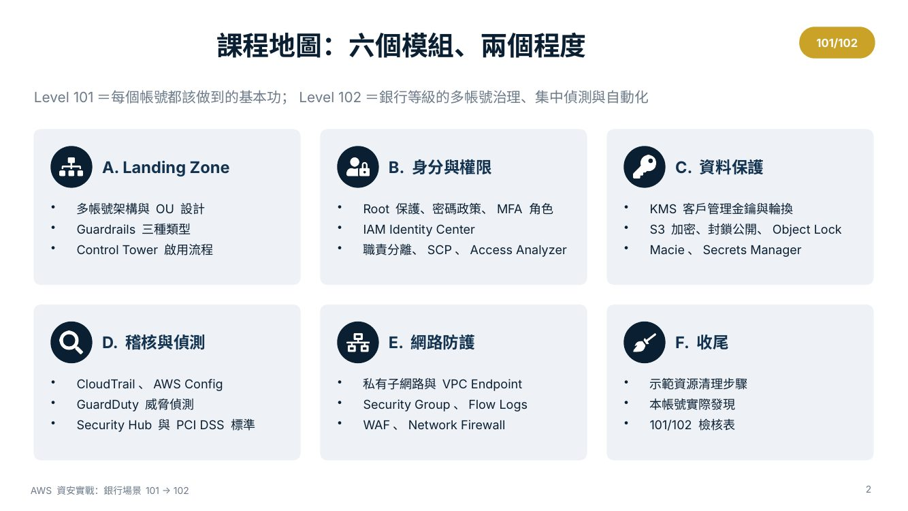
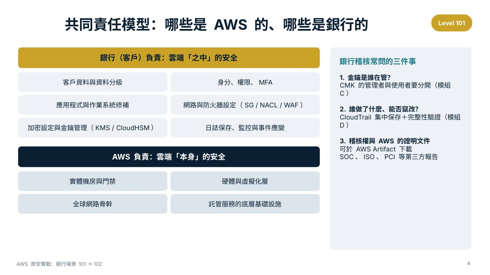

# AWS 資安實戰：銀行場景 Step by Step（101 → 102）

以「範例銀行」把網路銀行、核心周邊服務、信用卡資料處理三個系統搬上 AWS 為情境，
用**真實 AWS 主控台截圖**逐步示範每一個資安控制項，並附上可重現的 **AWS CLI 腳本**。

- **Level 101**：每個帳號都該做到的基本功
- **Level 102**：銀行等級的多帳號治理、集中偵測與自動化

> 截圖取自 `eu-central-1`（法蘭克福）繁體中文主控台。帳號 ID、IP、存取金鑰、SSO 網址等敏感資訊已遮蔽。
> 製作過程中建立的示範資源已全數刪除（KMS 金鑰依規定排程 7 天後刪除）。



---

## 目錄

| 模組 | 內容 | 101 | 102 | 文件 | 腳本 |
|---|---|:-:|:-:|---|---|
| A. Landing Zone | 多帳號架構、OU 設計、Guardrails、Control Tower、集中日誌 | ● | ● | [01-landing-zone.md](docs/01-landing-zone.md) | `05-landing-zone.sh` |
| B. 身分與權限 | Root 保護、密碼政策、MFA 角色、Identity Center、職責分離、SCP、Access Analyzer | ● | ● | [02-identity.md](docs/02-identity.md) | `01-iam.sh` |
| C. 資料保護 | KMS CMK 與輪換、S3 加密與封鎖公開、Object Lock、Macie、Secrets Manager | ● | ● | [03-data-protection.md](docs/03-data-protection.md) | `02-data-protection.sh` |
| D. 稽核與偵測 | CloudTrail、AWS Config、GuardDuty、Security Hub（PCI DSS）、自動化回應 | ● | ● | [04-detection.md](docs/04-detection.md) | `03-detection.sh` |
| E. 網路防護 | 私有子網路、VPC Endpoint、Security Group、Flow Logs、WAF、Network Firewall | ● | ● | [05-network.md](docs/05-network.md) | `04-network.sh` |
| F. 收尾 | 清理順序、實際發現、101/102 檢核表 | ● | | [06-cleanup-and-checklist.md](docs/06-cleanup-and-checklist.md) | `99-cleanup.sh` |

建議授課時間：101 約 3 小時、102 約 3 小時。

---

## 情境：範例銀行的三個工作負載

| 工作負載 | 特性 | 主要威脅 | 對應控制項 |
|---|---|---|---|
| 網路銀行（對外） | 面向網際網路的登入與交易頁 | 撞庫、Bot、DDoS、注入攻擊 | WAF、帳號接管防護、私有後端 |
| 核心系統周邊服務 | 存放客戶個資與帳務資料 | 資料外洩、權限濫用 | KMS CMK、私有子網路、最小權限 |
| 信用卡資料處理 | PCI DSS 持卡人資料環境（CDE） | 卡號外洩、稽核軌跡缺漏 | 獨立帳號、日誌不可竄改、PCI 標準檢查 |

### 共同責任模型



| 銀行（客戶）負責：雲端「之中」 | AWS 負責：雲端「本身」 |
|---|---|
| 客戶資料與資料分級、身分與權限、作業系統修補、SG / NACL / WAF 設定、加密與金鑰管理、日誌保存與事件應變 | 實體機房、硬體與虛擬化層、全球網路骨幹、託管服務底層 |

銀行稽核常問的三件事：**金鑰是誰在管**（模組 C）、**誰做了什麼且能否竄改**（模組 D）、**AWS 的第三方證明**（AWS Artifact 可下載 SOC、ISO、PCI 報告）。

> 實際導入請依貴行適用的主管機關規範（如金融機構作業委外與雲端服務相關規定）逐條對照，本教材不取代法遵意見。

---

## 快速開始（腳本）

### 前置需求

- AWS CLI v2、`jq`、bash 4+
- 已設定憑證（`aws configure` 或 `aws sso login`）。**請勿使用 Root**，建議用具管理權限的 IAM Identity Center 使用者
- 建議在**專用的實驗帳號**執行

### 執行

```bash
git clone https://github.com/ChunPingWang/it-security-with-aws.git
cd it-security-with-aws
export AWS_REGION=eu-central-1   # 預設值
export PREFIX=bank-demo          # 所有資源名稱前綴

# 0. 唯讀健檢（不建立任何資源）
./scripts/00-check-baseline.sh

# B. 身分與權限
./scripts/01-iam.sh all               # 密碼政策、MFA 稽核角色、Access Analyzer

# C. 資料保護
./scripts/02-data-protection.sh all   # CMK＋輪換、加密 S3、拒絕非 HTTPS 政策
./scripts/02-data-protection.sh account-bpa   # 帳號層級封鎖公開存取（建議保留）

# D. 稽核與偵測
./scripts/03-detection.sh all         # 事件歷史、GuardDuty、Security Hub（FSBP＋PCI DSS）
./scripts/03-detection.sh trail       # 多區域線索＋日誌檔驗證＋資料事件
./scripts/03-detection.sh config      # AWS Config＋受管規則

# E. 網路
./scripts/04-network.sh all           # 私有 VPC、S3 端點、最小 SG、Flow Logs
./scripts/04-network.sh waf           # WAF Web ACL（Count 模式）

# A. Landing Zone（需在 Organizations 管理帳號執行）
./scripts/05-landing-zone.sh status
./scripts/05-landing-zone.sh create-ous
./scripts/05-landing-zone.sh scp      # SCP 先掛到 Policy-Staging OU 驗證

# F. 清理（只刪除 .state/ 中記錄的資源）
./scripts/99-cleanup.sh
```

### 腳本設計原則

- **會變更帳號設定的動作一律先詢問確認**；`ASSUME_YES=true` 可在 CI 中略過
- **冪等**：資源已存在就略過，可重複執行
- **狀態檔**：建立的資源記錄在 `.state/<PREFIX>-<REGION>.env`，`99-cleanup.sh` 只刪除其中記錄的資源；既有的 GuardDuty / Security Hub 不會被停用
- **輸出遮蔽**：帳號 ID 只顯示前 4 碼
- 所有資源都加上標籤 `Project=<PREFIX>`

### 費用提醒

| 資源 | 費用 |
|---|---|
| KMS CMK | 約每月 1 美元（排程刪除期間仍計費） |
| GuardDuty / Security Hub CSPM | 首次啟用 30 天免費試用，之後依用量 |
| AWS Config | 依記錄的組態項目與規則評估次數 |
| CloudTrail | 第一份管理事件免費；資料事件與 S3 儲存另計 |
| WAF Web ACL | 每月約 5 美元＋每條規則＋請求數 |
| Network Firewall | 依端點小時與處理流量（腳本未自動建立） |

---

## 檔案結構

```
.
├── README.md
├── docs/
│   ├── 01-landing-zone.md
│   ├── 02-identity.md
│   ├── 03-data-protection.md
│   ├── 04-detection.md
│   ├── 05-network.md
│   ├── 06-cleanup-and-checklist.md
│   └── images/                    # 遮蔽後的主控台截圖
└── scripts/
    ├── lib/common.sh              # 共用設定、確認、狀態檔
    ├── 00-check-baseline.sh       # 唯讀健檢
    ├── 01-iam.sh                  # 模組 B
    ├── 02-data-protection.sh      # 模組 C
    ├── 03-detection.sh            # 模組 D
    ├── 04-network.sh              # 模組 E
    ├── 05-landing-zone.sh         # 模組 A
    ├── 99-cleanup.sh              # 模組 F
    └── policies/
        ├── trust-mfa-same-account.json
        ├── s3-deny-insecure-transport.json
        ├── s3-restrict-to-vpce.json
        ├── log-bucket-cloudtrail-config.json
        ├── scp-protect-audit-baseline.json
        ├── scp-region-deny.json
        ├── waf-managed-rules.json
        └── control-tower-manifest.json
```

---

## 101 / 102 檢核表

| 領域 | Level 101（每個帳號必做） | Level 102（銀行等級） |
|---|---|---|
| Landing Zone | 了解多帳號必要性 | Control Tower、OU 設計、區域拒絕、Account Factory |
| 身分與權限 | Root MFA、無 Root 金鑰、密碼政策、MFA 角色 | Identity Center＋AD、Permission Set 職責分離、SCP、Access Analyzer |
| 資料保護 | CMK、自動輪換、S3 SSE-KMS、封鎖公開、版本控制 | 金鑰管理與使用分離、Object Lock、Macie、Secrets Manager、BYOK / CloudHSM |
| 稽核與偵測 | CloudTrail 線索＋驗證、Config 規則 | Organization Trail、資料事件、GuardDuty、Security Hub PCI DSS、自動化回應 |
| 網路 | 私有子網路、VPC Endpoint、最小 SG、Flow Logs | WAF ATP、Network Firewall 檢查 VPC、TGW 集中出口、CDE 隔離 |

---

## 免責聲明

本教材與腳本僅供教學與實驗用途。請先在非正式帳號驗證，並依貴行的資安政策、變更管理流程與適用法規調整後再用於正式環境。
示範中的數值（密碼長度、保存期限、輪換週期等）僅為範例。
