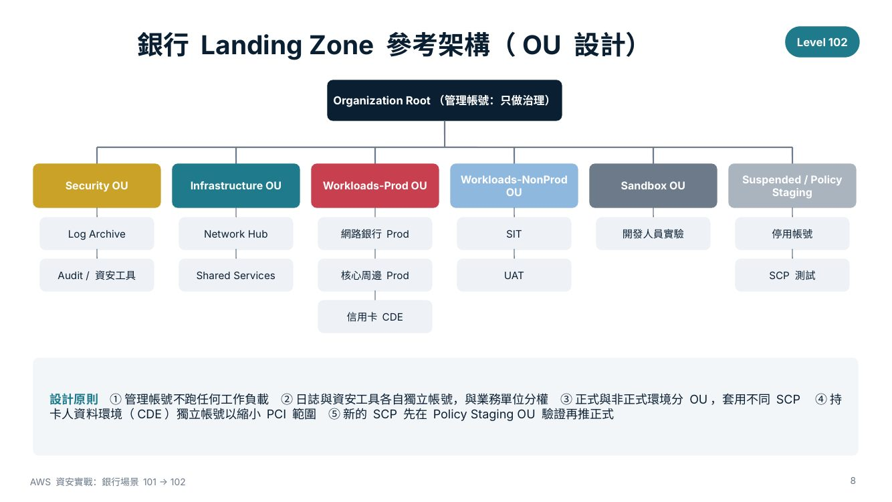
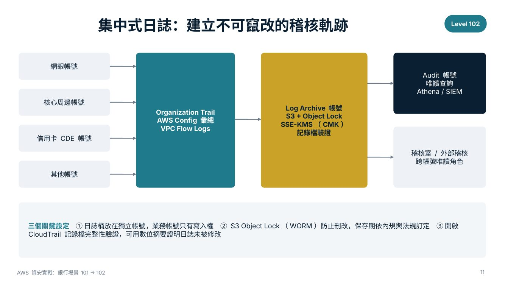
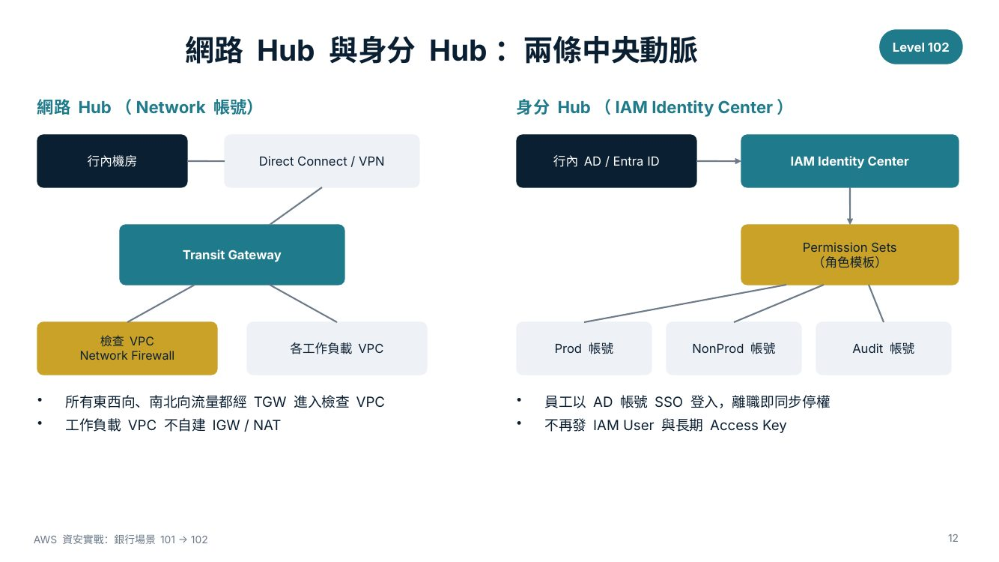
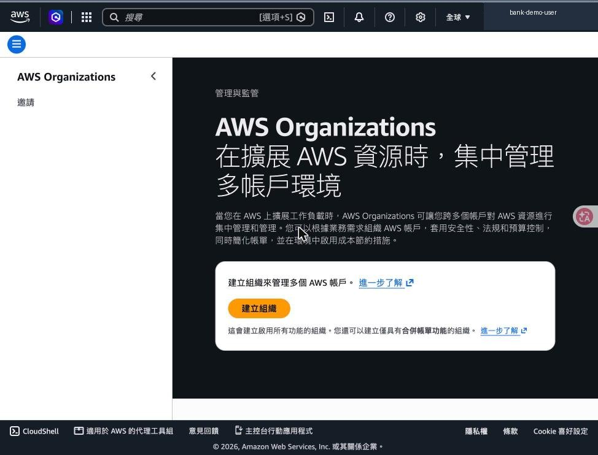
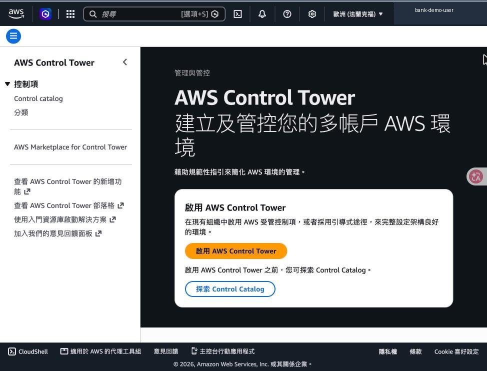
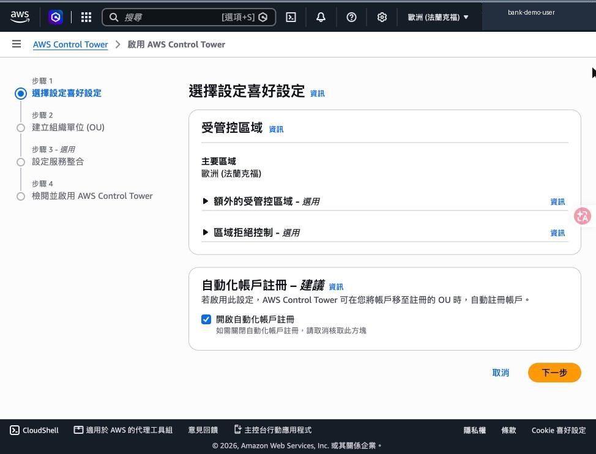
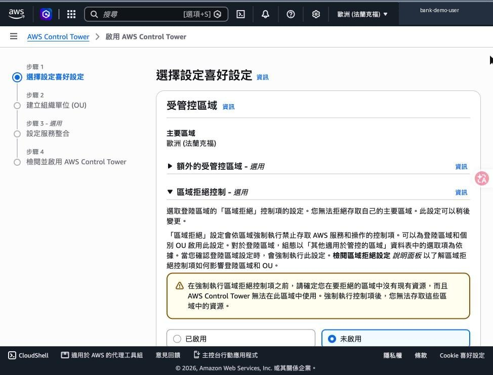
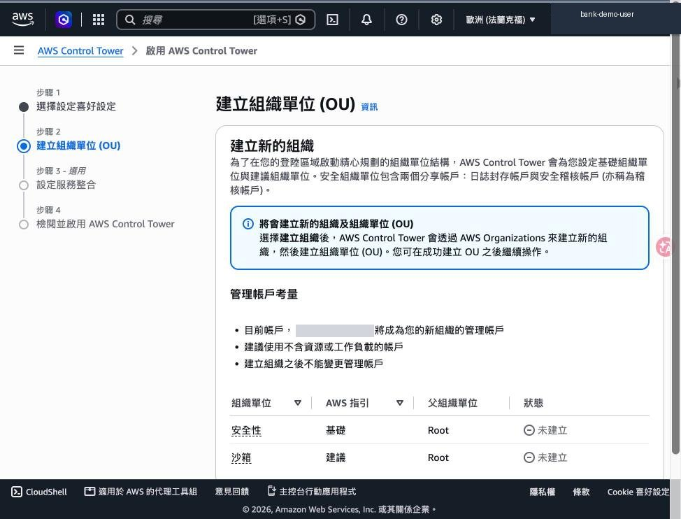
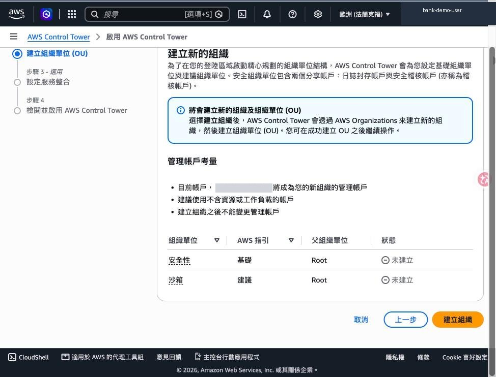

# 模組 A｜Landing Zone 多帳號基礎

> [模組 A](01-landing-zone.md)・[模組 B](02-identity.md)・[模組 C](03-data-protection.md)・[模組 D](04-detection.md)・[模組 E](05-network.md)・[模組 F](06-cleanup-and-checklist.md)

- 先把「房子的地基與隔間」蓋好，後面每一個控制項才有地方放

對應腳本：[`scripts/05-landing-zone.sh`](../scripts/05-landing-zone.sh)

## 為什麼銀行不能只用一個 AWS 帳號 `Level 101`

**單一帳號的問題**

- 正式與測試環境共用權限邊界，一把鑰匙開所有門
- 日誌與被稽核的系統放在同一個帳號，管理者可以刪改
- 費用、事件影響範圍（blast radius）難以切分
- PCI 範圍無法縮小，整個帳號都要受檢

**多帳號 Landing Zone 的好處**

- 帳號＝最強的隔離邊界：網銀、核心、信用卡各自獨立
- Log Archive 帳號集中保存日誌，業務單位無權刪除
- SCP 從組織層級統一禁止高風險動作
- 新帳號由 Account Factory 標準化開立，內建所有基線

<sub>AWS 官方建議以多帳號作為隔離與治理的基本單位，Control Tower 是 AWS 提供的託管 Landing Zone 方案。</sub>

## 銀行 Landing Zone 參考架構（OU 設計） `Level 102`



<sub>Control Tower 預設建立 Security OU（含 Log Archive 與 Audit 兩個共用帳號）與建議的 Sandbox OU，其餘 OU 依銀行需求自行加開。</sub>

## 每個帳號的職責與銀行內部對應 `Level 102`

| 帳號 | 主要用途 | 存取者 | 銀行內部對應 |
|---|---|---|---|
| Management | Organizations、Control Tower、帳單、SCP | 雲端平台治理小組（極少數） | IT 治理委員會授權 |
| Log Archive | 集中存放 CloudTrail、Config、Flow Logs，Object Lock 保存 | 資安稽核唯讀 | 稽核室、法遵 |
| Audit / Security Tooling | GuardDuty、Security Hub、Macie 委派管理員 | SOC / 資安處 | 資安監控中心 |
| Network Hub | Transit Gateway、檢查 VPC、Direct Connect 對接 | 網路團隊 | 網路科 |
| Shared Services | AD 連接、CI/CD、映像檔、DNS | 平台團隊 | 系統管理科 |
| Workload（Prod / NonProd） | 網銀、核心周邊、信用卡 CDE 等應用 | 應用團隊（Prod 僅限部署管線） | 各業務系統負責單位 |

<sub>表格可直接作為與資安處、稽核室討論 RACI 的起點。</sub>

## Guardrails 三種類型：預防、偵測、主動 `Level 102`

**預防型 Preventive**

- 以 SCP / RCP 在 API 呼叫前直接拒絕
- 例：禁止停用 CloudTrail、禁止離開核准區域
- 例：禁止 Root 使用者操作
- 效果最強，需先在測試 OU 驗證

**偵測型 Detective**

- 以 AWS Config 規則持續評估組態
- 例：S3 是否開放公開存取、EBS 是否加密
- 不阻擋，但會產生不合規告警
- 搭配 Security Hub 統一呈現

**主動型 Proactive**

- 以 CloudFormation Hooks 在部署前檢查
- 例：IaC 範本未加密的資源不可建立
- 把檢查左移到 CI/CD 管線
- 適合大量自動化開帳號的銀行

<sub>Control Tower 的控制項（controls）即以這三種型態實作，可在 Control Catalog 中依框架篩選。</sub>

## 集中式日誌：建立不可竄改的稽核軌跡 `Level 102`



<sub>日誌保存年限請依貴行內規與適用法規設定；Object Lock 的合規模式（Compliance mode）連 root 都無法提前刪除，設定前務必確認。</sub>

## 網路 Hub 與身分 Hub：兩條中央動脈 `Level 102`



<sub>這兩個 Hub 分別在模組 B（身分）與模組 E（網路）中有實際操作截圖。</sub>

## Step 1：在管理帳號開啟 AWS Organizations `Level 102`



**建立組織＝Landing Zone 的起點**

- 以預計作為「管理帳號」的帳號登入主控台
- 進入 AWS Organizations，按「建立組織」
- 會啟用「所有功能」模式，才能使用 SCP 與委派管理員
- 管理帳號建立後無法更換，請選一個乾淨、不跑工作負載的帳號

> 🏦 **銀行重點**：管理帳號的 Root 需由兩人保管（密碼與 MFA 分持），並納入特權帳號管理程序。

<sub>本示範帳號未建立組織，只截圖到此頁，未實際按下建立。</sub>

<details><summary>CLI 對應</summary>

```bash
./scripts/05-landing-zone.sh create-org
# 等同：aws organizations create-organization --feature-set ALL
```
</details>

## Step 2：啟用 AWS Control Tower `Level 102`



**用託管方式部署 Landing Zone**

- Control Tower 會自動建立 Organizations、OU、共用帳號與基線控制項
- 已有組織者，可在既有組織上啟用受管控制項
- 啟用前可先「探索 Control Catalog」了解可用控制項
- 整個部署約需數十分鐘

> ⚠️ **注意**：Control Tower 會建立新帳號且不易回復，正式導入前建議先在獨立的實驗組織演練一次。

## Step 3：選擇主要區域與受管控區域 `Level 102`



**決定資料可以落在哪些區域**

- 主要區域＝目前登入的區域，Landing Zone 的共用資源會建在這裡
- 「額外的受管控區域」：其他要套用控制項的區域
- 「自動化帳戶註冊」：帳號移入已註冊 OU 時自動納管
- 主要區域之後無法任意更改，請先與法遵確認資料落地要求

> 🏦 **銀行重點**：多數銀行會以資料落地與災備需求決定區域，例如主要區域＋一個災備區域。

## Step 4：開啟「區域拒絕」控制項 `Level 102`



**禁止在核准區域以外建立資源**

- 區域拒絕會以 SCP 禁止在未受管控區域呼叫大部分 AWS API
- 全域服務（如 IAM、Organizations）不受影響
- 啟用前確認被拒絕的區域沒有既有資源，否則之後無法存取
- 可針對整個登陸區或個別 OU 設定

> 🏦 **銀行重點**：這是「資料不出指定區域」最直接的技術證據，稽核時可出示 SCP 內容與啟用紀錄。

<details><summary>CLI 對應</summary>

```bash
ALLOWED_REGIONS=eu-central-1,eu-west-1 ./scripts/05-landing-zone.sh scp
# 政策內容：scripts/policies/scp-region-deny.json
```
</details>

## Step 5：建立基礎 OU 與共用帳號 `Level 102`



**Security OU：Log Archive＋Audit**

- 基礎 OU「安全性」會包含兩個共用帳號：日誌封存帳戶與安全稽核帳戶
- 建議 OU「沙箱」給開發人員實驗用
- 其他 OU（Workloads-Prod、Infrastructure…）在完成後自行新增
- 目前帳號將成為新組織的管理帳號

> 🏦 **銀行重點**：Log Archive 與 Audit 帳號的 Email 請使用銀行內部的群組信箱，避免個人離職造成帳號失聯。

<details><summary>CLI 對應</summary>

```bash
./scripts/05-landing-zone.sh create-ous
# Control Tower 以 manifest 部署（需先建立 Log Archive / Audit 帳號）：
# aws controltower create-landing-zone --landing-zone-version 3.3 \
#   --manifest file://scripts/policies/control-tower-manifest.json
```
</details>

## Step 6：確認並建立組織 `Level 102`



**按下前的最後檢查**

- 建議使用「不含資源或工作負載」的帳號作為管理帳號
- 建立組織之後不能變更管理帳號
- 之後還有「服務整合」與「檢閱並啟用」兩步
- 本示範停在此頁，未實際建立

> 🏦 **銀行重點**：啟用後，到 Control Catalog 依框架（如 NIST、PCI DSS）篩選並啟用額外控制項。

## Landing Zone 上線檢核清單 `Level 102`

| # | 檢核項目 | 驗證方式 | 負責單位 |
|---|---|---|---|
| 1 | 管理帳號 Root 已設 MFA、無 Access Key，由雙人保管 | IAM 儀表板安全建議全為綠勾 | 雲端治理小組 |
| 2 | Security OU 已建立 Log Archive 與 Audit 帳號 | Organizations 主控台 OU 樹 | 雲端治理小組 |
| 3 | Organization Trail 開啟、日誌桶啟用 Object Lock 與 SSE-KMS | CloudTrail 線索清單、S3 屬性 | 資安處 |
| 4 | 區域拒絕、禁止停用 CloudTrail / GuardDuty 的 SCP 已套用 | Control Tower 控制項狀態 | 資安處 |
| 5 | GuardDuty、Security Hub 以 Audit 帳號為委派管理員 | Security Hub 帳戶頁 | SOC |
| 6 | 員工一律透過 Identity Center SSO 登入 | IAM 使用者數量為 0（或僅緊急帳號） | 身分管理 |
| 7 | 新帳號由 Account Factory 開立，自動套用基線 | 帳號開立紀錄與工單對照 | 平台團隊 |

<sub>可直接轉成內部驗收表單。</sub>


---

[← 回到 README](../README.md)
