# 模組 B｜身分與權限

> [模組 A](01-landing-zone.md)・[模組 B](02-identity.md)・[模組 C](03-data-protection.md)・[模組 D](04-detection.md)・[模組 E](05-network.md)・[模組 F](06-cleanup-and-checklist.md)

- 101：Root 保護、密碼政策、MFA 角色
- 102：Identity Center、職責分離、Access Analyzer、SCP

對應腳本：[`scripts/01-iam.sh`](../scripts/01-iam.sh)

## IAM 三個核心觀念 `Level 101`

**Root 使用者**

- 擁有帳號所有權限且無法被限制
- 只用於少數必要操作（如關閉帳號）
- 必設 MFA、不可有 Access Key
- 日常操作一律改用角色

**角色優於使用者**

- 角色＝臨時憑證，自動過期
- 使用者＝長期密碼與金鑰，易外洩
- 人員走 SSO，程式走角色
- Access Key 僅保留給無法用角色的例外

**政策評估邏輯**

- 預設全部拒絕
- 明確 Deny 一律優先
- SCP、權限邊界、身分政策、資源政策取交集
- 最小權限：從唯讀開始逐步放寬

<sub>接下來的步驟頁都會回到這三個觀念。</sub>

## Step 1：檢查 IAM 儀表板的安全建議 `Level 101`

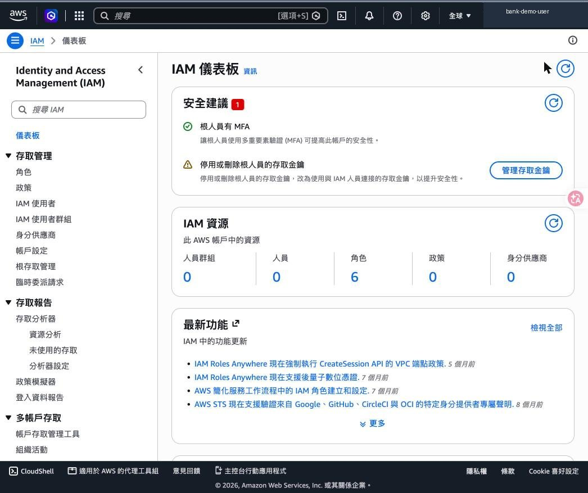

**第一個畫面就要全部綠燈**

- 「根人員有 MFA」顯示綠勾：已完成
- 「停用或刪除根人員的存取金鑰」為警告：本帳號 Root 仍有 Access Key
- 按「管理存取金鑰」可停用或刪除
- 下方「IAM 資源」可快速看出 IAM 使用者是否歸零

> ⚠️ **注意**：Root Access Key 是銀行稽核的高風險項目，應立即停用並刪除，必要時以工單留下紀錄。

<sub>這是本示範帳號實際存在的發現，已列在最後的「本帳號實際發現」頁。</sub>

<details><summary>CLI 對應</summary>

```bash
./scripts/00-check-baseline.sh
# 或：aws iam get-account-summary --query 'SummaryMap.[AccountMFAEnabled,AccountAccessKeysPresent]'
```
</details>

## Step 2：進入帳戶設定的密碼政策 `Level 101`

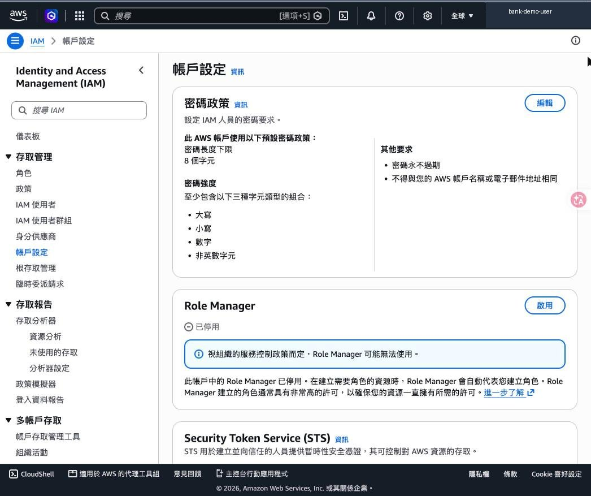

**預設政策對銀行不夠**

- 左側選「帳戶設定」
- 預設：最少 8 個字元、三種字元類型、密碼永不過期
- 按「編輯」修改
- 同頁的 STS 區段可控制哪些區域可發臨時憑證

> 🏦 **銀行重點**：若全面改用 Identity Center，此政策只影響少數緊急用 IAM 使用者，但仍需符合內部密碼規範。

## Step 3：設定符合銀行規範的密碼政策 `Level 101`

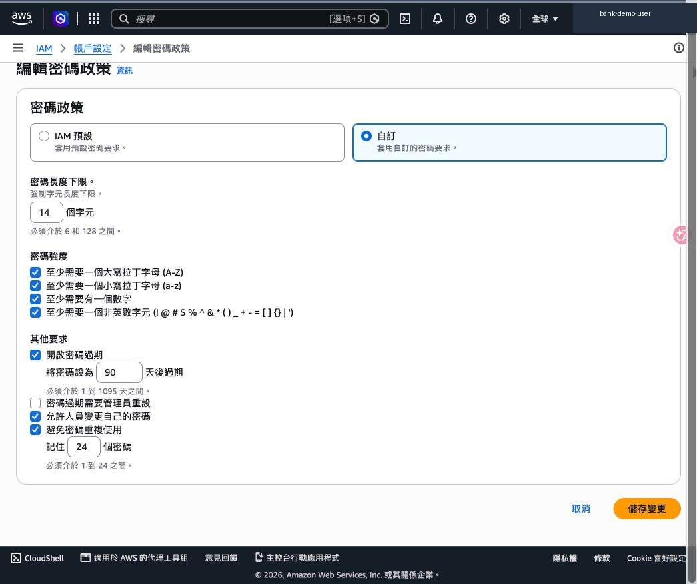

**示範值：14 碼、90 天、記住 24 組**

- 選「自訂」
- 長度下限 14、四種字元類型全勾
- 開啟密碼過期：90 天
- 允許使用者變更自己的密碼
- 避免重複使用：記住 24 個密碼
- 按「儲存變更」生效（本示範未儲存）

> 🏦 **銀行重點**：實際數值請依貴行資安政策；示範值僅供參考。

<details><summary>CLI 對應</summary>

```bash
./scripts/01-iam.sh password-policy
```
</details>

## Step 4：建立稽核唯讀角色－選擇信任實體 `Level 101`

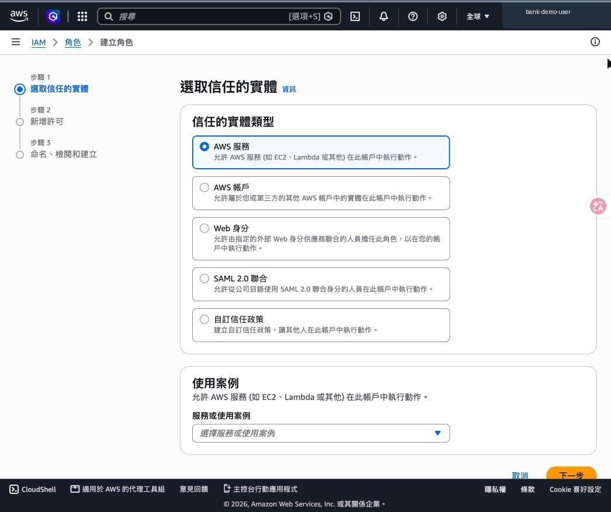

**情境：內部稽核要能查、不能改**

- IAM → 角色 → 建立角色
- 信任實體類型選「AWS 帳戶」
- 其他選項：AWS 服務、Web 身分、SAML 2.0 聯合、自訂信任政策
- 跨帳號稽核時改選「另一個 AWS 帳戶」並填 Audit 帳號 ID

## Step 5：要求擔任角色時必須通過 MFA `Level 101`

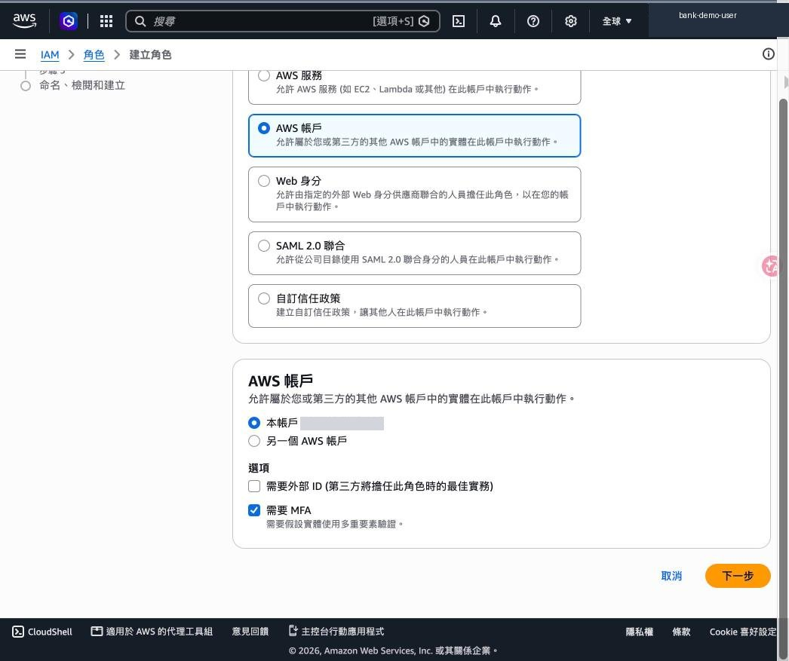

**勾選「需要 MFA」**

- 選「本帳戶」
- 勾選「需要 MFA」，信任政策會自動加入 MFA 條件
- 第三方擔任角色時，另勾「需要外部 ID」防止混淆代理人攻擊
- 按「下一步」

> 🏦 **銀行重點**：特權與稽核角色都應強制 MFA，這是多數銀行內控的基本要求。

## Step 6：附加 AWS 受管政策 SecurityAudit `Level 101`

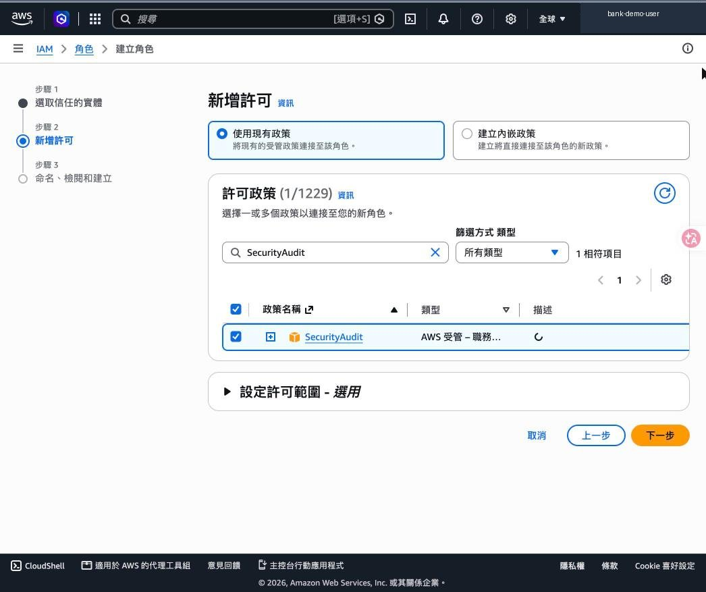

**先用唯讀，再逐步放寬**

- 搜尋並勾選「SecurityAudit」
- 此政策可讀取各服務的安全組態，不能修改
- 需要更細的查詢權時，再加 ViewOnlyAccess 或自訂政策
- 可在「設定許可範圍」加上權限邊界（102）

## Step 7：命名角色並加上說明 `Level 101`

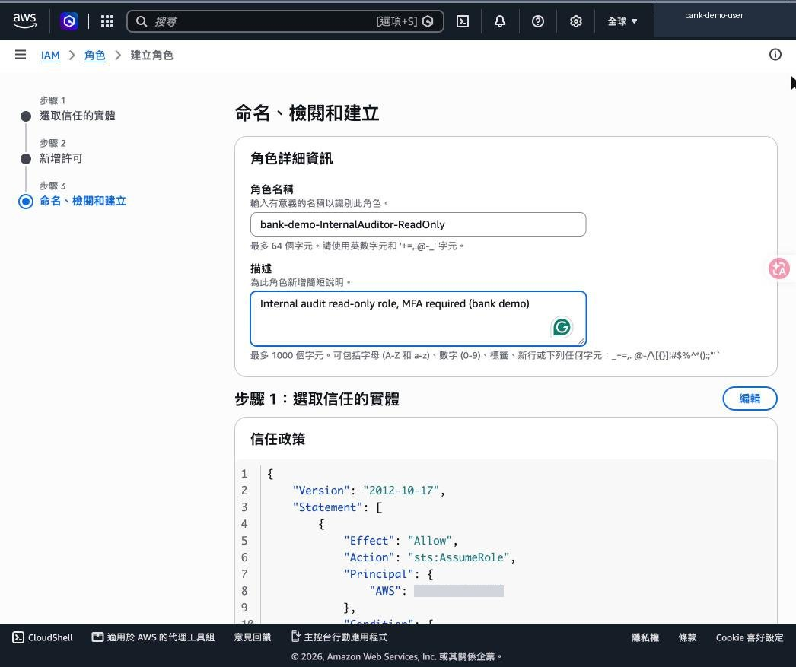

**命名規則就是治理**

- 名稱：bank-demo-InternalAuditor-ReadOnly
- 建議格式：<環境>-<職能>-<權限層級>
- 描述寫清楚用途與核准單位
- 名稱建立後無法修改

> 🏦 **銀行重點**：統一的命名規則能讓稽核人員從名稱判斷角色用途，也便於用 SCP 以名稱前綴保護特權角色。

## Step 8：檢閱信任政策中的 MFA 條件 `Level 101`

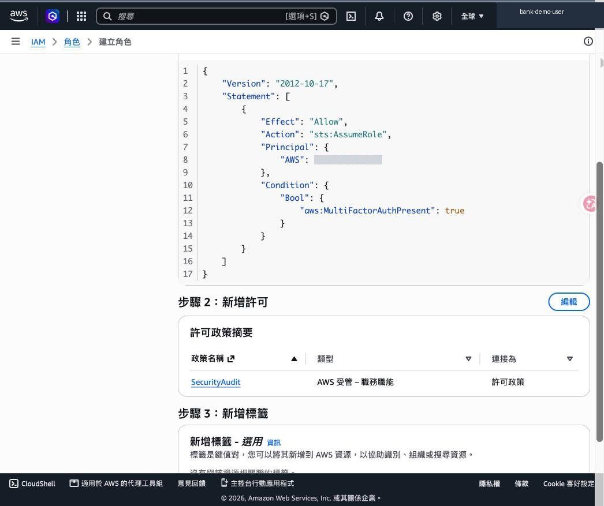

**看懂自動產生的 JSON**

- Principal：允許本帳號的身分擔任此角色
- Condition：aws:MultiFactorAuthPresent = true
- 未使用 MFA 登入的人無法擔任此角色
- 許可政策摘要顯示 SecurityAudit

## Step 9：新增標籤並建立角色 `Level 101`

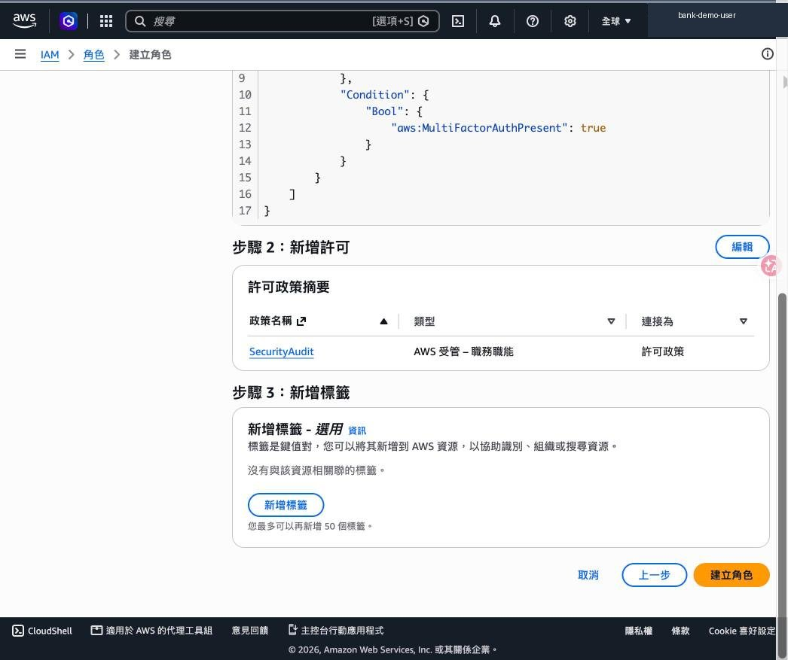

**建議加上標籤後再建立**

- 標籤例：Owner=稽核室、DataClass=Internal
- 按「建立角色」完成
- 本示範停在此頁，未實際建立
- 建立後，使用者以「切換角色」進入，所有動作記入 CloudTrail

<details><summary>CLI 對應</summary>

```bash
./scripts/01-iam.sh auditor-role
# 信任政策：scripts/policies/trust-mfa-same-account.json
```
</details>

## Step 10：IAM Identity Center 儀表板 `Level 102`

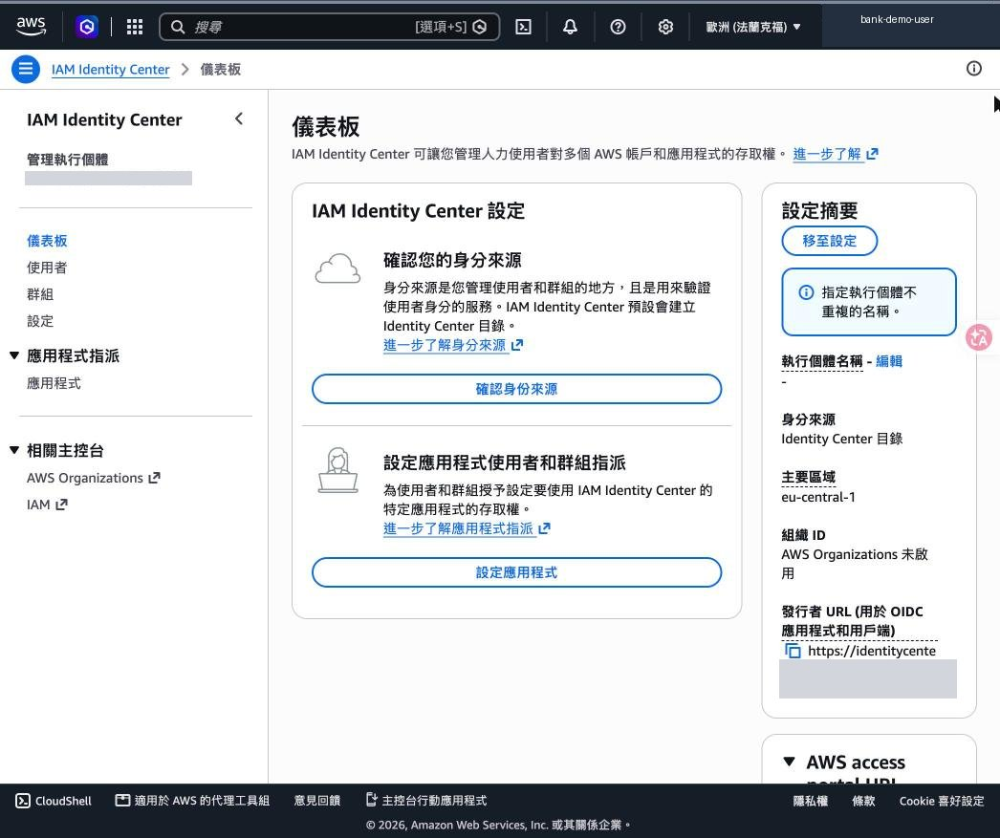

**員工登入的單一入口**

- 身分來源預設為 Identity Center 目錄，可改接 AD 或外部 IdP
- 設定摘要顯示主要區域與組織狀態
- 本帳號為「獨立帳戶執行個體」，未接 Organizations
- 正式環境應在管理帳號建立「組織執行個體」

> 🏦 **銀行重點**：接上行內 AD 後，人員異動（到職、調職、離職）可自動同步，減少人工開關權限的疏漏。

## Step 11：檢視身分來源與執行個體設定 `Level 102`

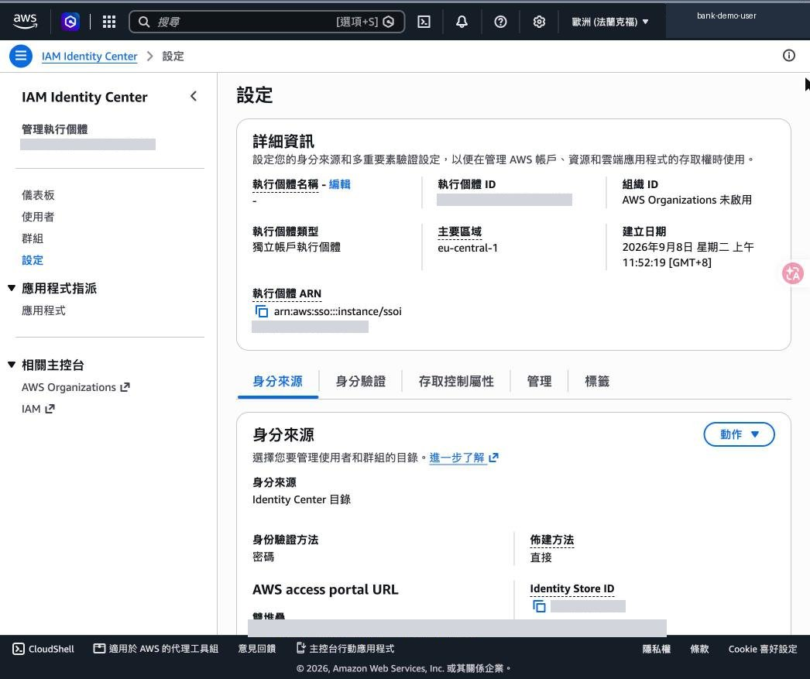

**設定 → 四個分頁**

- 身分來源：選擇 AD、外部 IdP 或內建目錄
- 身分驗證：MFA 與工作階段
- 存取控制屬性：以部門、職級等屬性做 ABAC
- 管理：委派管理員

## Step 12：強制 MFA 與工作階段時間 `Level 102`

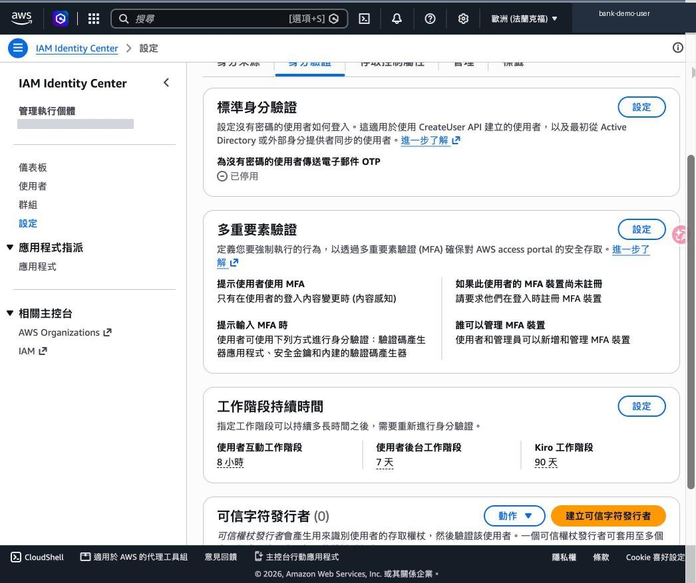

**身分驗證分頁**

- 多重要素驗證：可設定每次登入都要求 MFA
- MFA 裝置未註冊時，要求使用者登入時註冊
- 工作階段持續時間：預設互動 8 小時
- 銀行可依內規縮短，例如 1 至 4 小時

> 🏦 **銀行重點**：建議要求 FIDO2 安全金鑰或驗證器 App，並禁止以簡訊作為唯一第二因子。

## 職責分離（SoD）：用 Permission Set 落實 `Level 102`

同一人不應同時擁有「建立／修改」與「核准／稽核」權限；以下為示範對照

| Permission Set | Prod 帳號 | NonProd 帳號 | Log Archive | Audit | 需雙人核准 |
|---|---|---|---|---|---|
| PlatformAdmin | 受限管理（破窗） | 管理 | — | — | 是 |
| AppDeveloper | 唯讀 | 開發者權限 | — | — | 否 |
| SecurityOps | 唯讀＋事件處置 | 唯讀 | 唯讀 | 管理 | 是 |
| InternalAuditor | SecurityAudit | SecurityAudit | 唯讀 | 唯讀 | 否 |
| KeyAdministrator | 僅 KMS 管理 | 僅 KMS 管理 | — | — | 是 |
| BreakGlass（緊急） | AdministratorAccess | — | — | — | 是，事後檢討 |

<sub>Permission Set 會在每個被指派的帳號中產生對應的 IAM 角色。</sub>

## SCP 範例：保護稽核基線不被關閉 `Level 102`

```json
{
  "Version": "2012-10-17",
  "Statement": [
    {
      "Sid": "DenyDisableAuditBaseline",
      "Effect": "Deny",
      "Action": [
        "cloudtrail:StopLogging",
        "cloudtrail:DeleteTrail",
        "guardduty:DeleteDetector",
        "guardduty:DisassociateFromMasterAccount",
        "securityhub:DisableSecurityHub",
        "config:StopConfigurationRecorder",
        "config:DeleteConfigurationRecorder"
      ],
      "Resource": "*",
      "Condition": {
        "ArnNotLike": {
          "aws:PrincipalArn": "arn:aws:iam::*:role/BankPlatformAdmin"
        }
      }
    },
    {
      "Sid": "DenyRootUser",
      "Effect": "Deny",
      "Action": "*",
      "Resource": "*",
      "Condition": {
        "StringLike": { "aws:PrincipalArn": "arn:aws:iam::*:root" }
      }
    }
  ]
}
```

**套用在 Workloads OU**

- 第一段：除平台管理角色外，任何人都不能關閉 CloudTrail、GuardDuty、Security Hub、Config
- 第二段：成員帳號的 Root 一律拒絕
- SCP 不影響管理帳號本身
- 先掛在 Policy Staging OU 驗證，再推到正式 OU

<sub>SCP 需要 Organizations 的「所有功能」模式；本示範帳號未建立組織，故以程式碼示意。角色名稱為示範用。</sub>

<details><summary>CLI 對應</summary>

```bash
./scripts/05-landing-zone.sh scp          # 先掛 Policy-Staging OU
./scripts/05-landing-zone.sh promote-scp  # 驗證後推到 Workloads OU
```
</details>

## Step 13：IAM Access Analyzer 分析器設定 `Level 102`

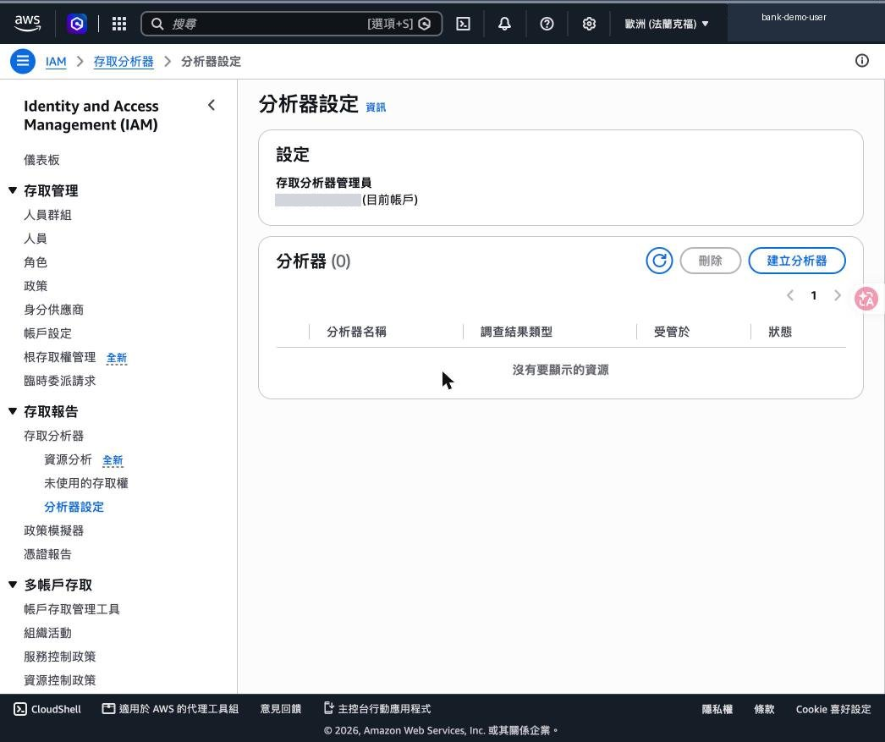

**找出「被外部存取」的資源**

- IAM → 存取分析器 → 分析器設定
- 目前沒有分析器，按「建立分析器」
- 左側「多帳戶存取」下可看到 SCP 與 RCP 入口
- 政策模擬器可在上線前測試權限

## Step 14：建立外部存取分析器 `Level 102`

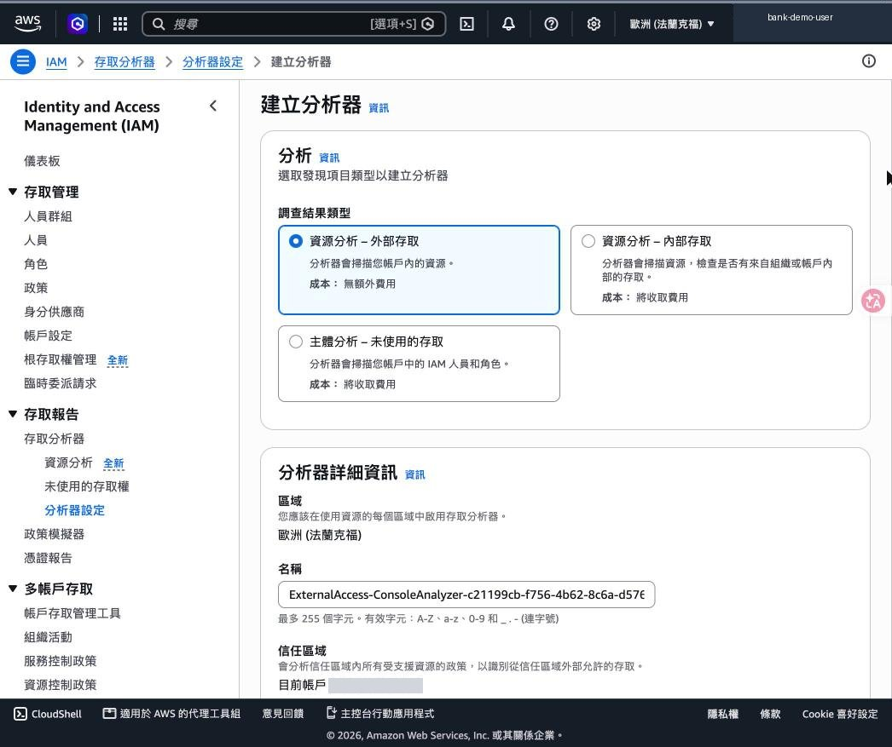

**三種分析器，成本不同**

- 資源分析－外部存取：無額外費用，建議所有帳號都開
- 資源分析－內部存取：檢查組織內的存取，需付費
- 主體分析－未使用的存取：找出閒置權限，需付費
- 信任區域：單一帳號或整個組織

> 🏦 **銀行重點**：「未使用的存取」報告可作為每季權限覆核（Access Review）的佐證資料。

<details><summary>CLI 對應</summary>

```bash
./scripts/01-iam.sh access-analyzer
aws accessanalyzer list-findings-v2 --analyzer-arn <ARN> --filter '{"status":{"eq":["ACTIVE"]}}'
```
</details>

## Step 15：SCP 需要先有組織 `Level 102`

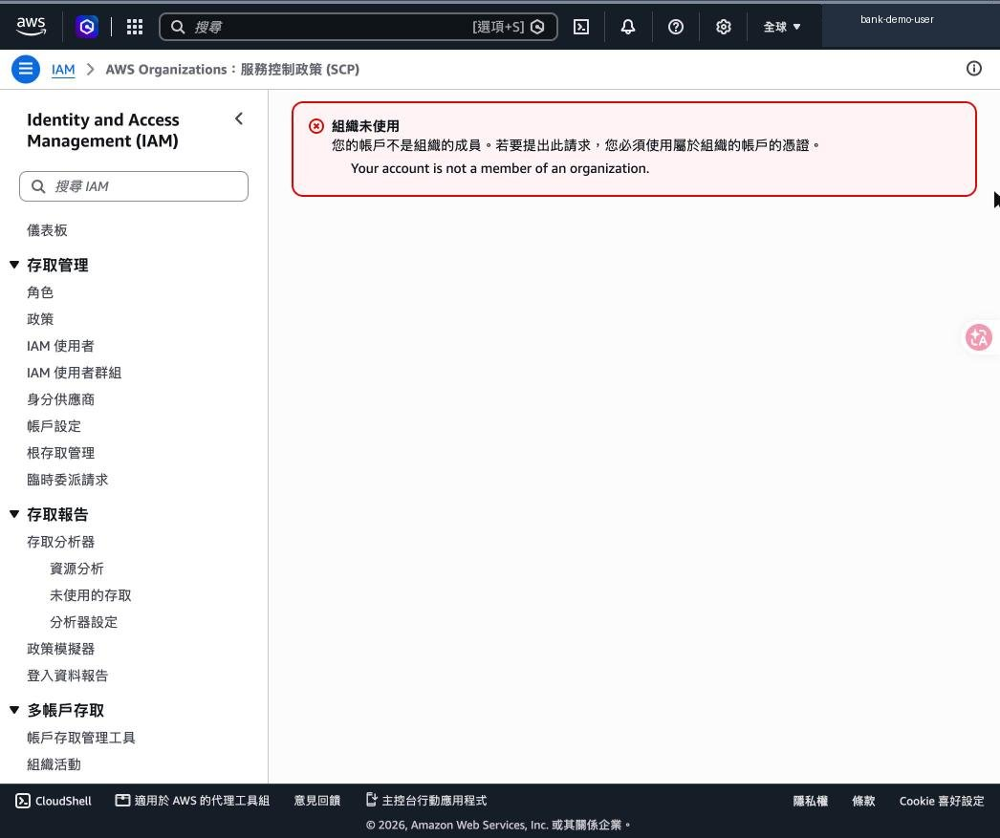

**單一帳號無法使用 SCP**

- 點選「服務控制政策」出現「組織未使用」
- SCP、RCP、委派管理員都依賴 Organizations
- 這也是銀行一定要做 Landing Zone 的原因之一
- 回到模組 A 的 Step 1 建立組織


---

[← 回到 README](../README.md)
