# 模組 C｜資料保護與加密

> [模組 A](01-landing-zone.md)・[模組 B](02-identity.md)・[模組 C](03-data-protection.md)・[模組 D](04-detection.md)・[模組 E](05-network.md)・[模組 F](06-cleanup-and-checklist.md)

- 101：KMS 客戶管理金鑰、S3 加密與封鎖公開
- 102：金鑰職責分離、Object Lock、Macie、Secrets Manager

對應腳本：[`scripts/02-data-protection.sh`](../scripts/02-data-protection.sh)

## 信封加密與金鑰選擇階梯 `Level 101`

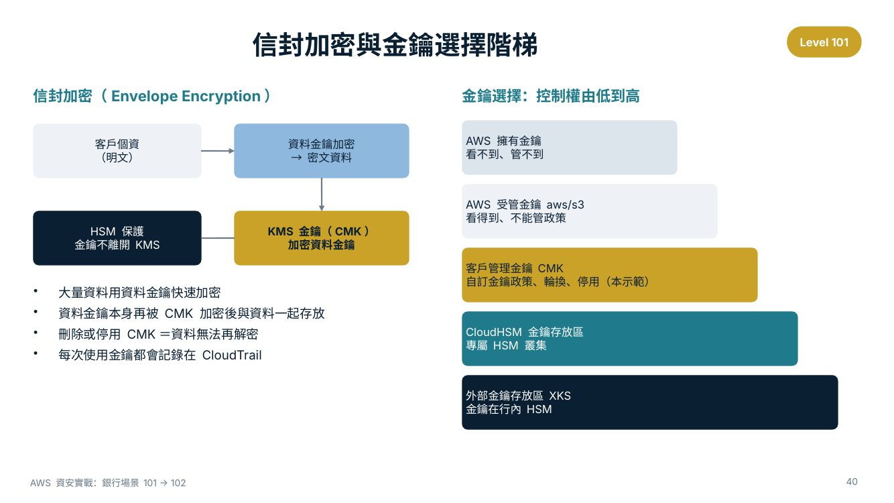

<sub>銀行最常見的選擇是 CMK；對金鑰主權有更高要求時考慮 CloudHSM 或 XKS，但成本與維運複雜度明顯提高。</sub>

## Step 1：建立 KMS 客戶管理金鑰 `Level 101`

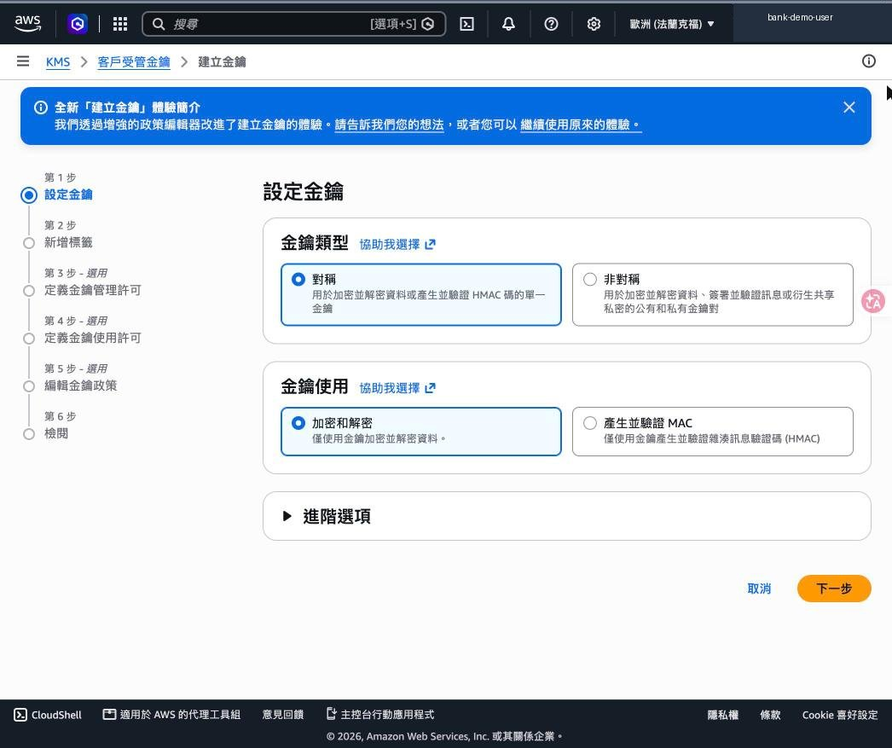

**對稱金鑰＋加密和解密**

- KMS → 客戶受管金鑰 → 建立金鑰
- 金鑰類型：對稱（S3、EBS、RDS 等服務加密都用這種）
- 金鑰使用：加密和解密
- 非對稱金鑰用於數位簽章，例如交易電文簽章

<sub>本步驟實際建立了 bank-demo-customer-pii-key，費用約每月 1 美元，已於最後排程刪除。</sub>

## Step 2：進階選項－金鑰材料來源 `Level 102`

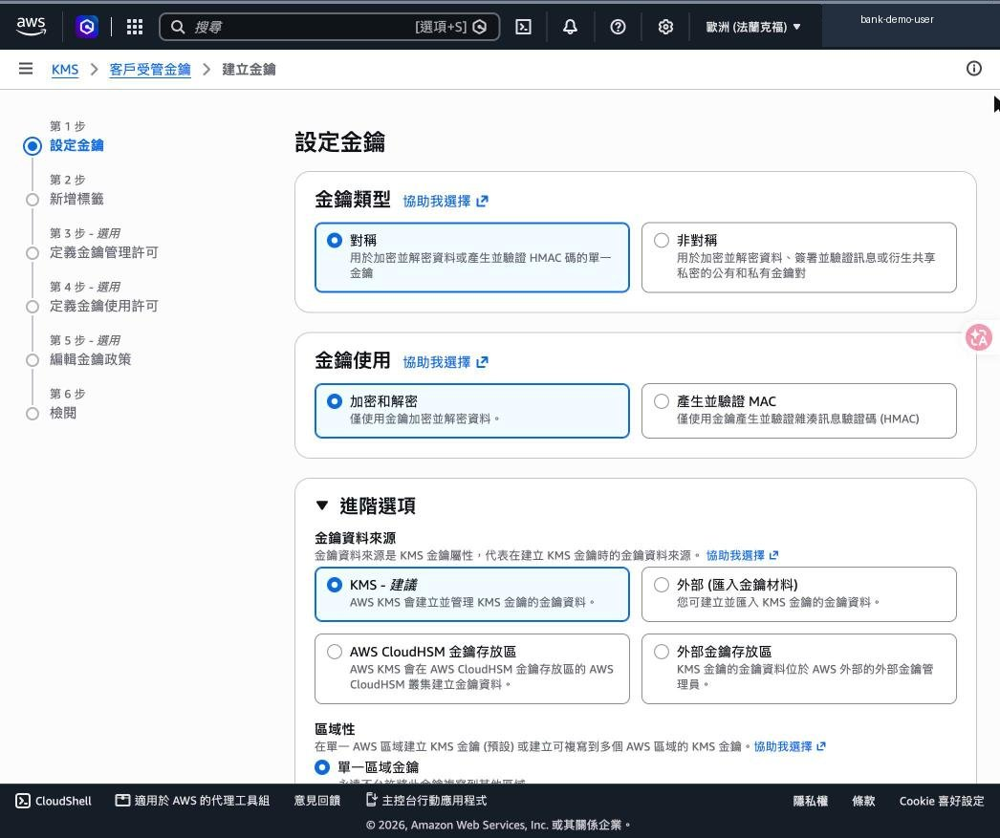

**金鑰主權的關鍵選擇**

- KMS（建議）：由 AWS KMS 產生並管理
- 外部（匯入金鑰材料）：自帶金鑰 BYOK
- AWS CloudHSM 金鑰存放區：在專屬 HSM 中產生
- 外部金鑰存放區：金鑰材料留在 AWS 之外
- 區域性：單一區域或多區域金鑰

> 🏦 **銀行重點**：若內規要求「金鑰由銀行自行產生與保管」，可評估 BYOK、CloudHSM 或 XKS，並同步評估可用性與維運責任。

## Step 3：設定別名、描述與資料分級標籤 `Level 101`

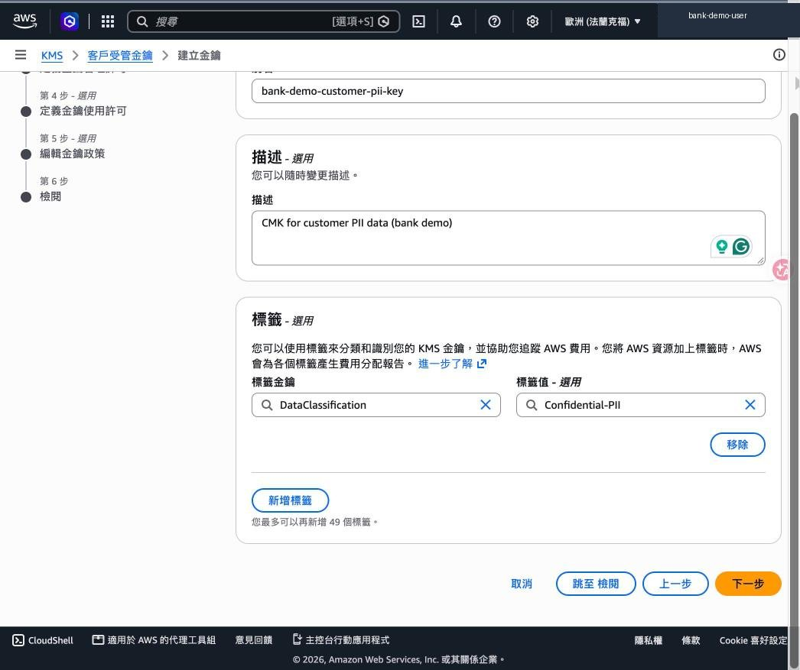

**讓金鑰「看得懂用途」**

- 別名：bank-demo-customer-pii-key
- 描述：CMK for customer PII data
- 標籤：DataClassification＝Confidential-PII
- 標籤可用於成本分攤，也可在 IAM 條件中做 ABAC

## Step 4：定義金鑰管理員（職責分離） `Level 102`

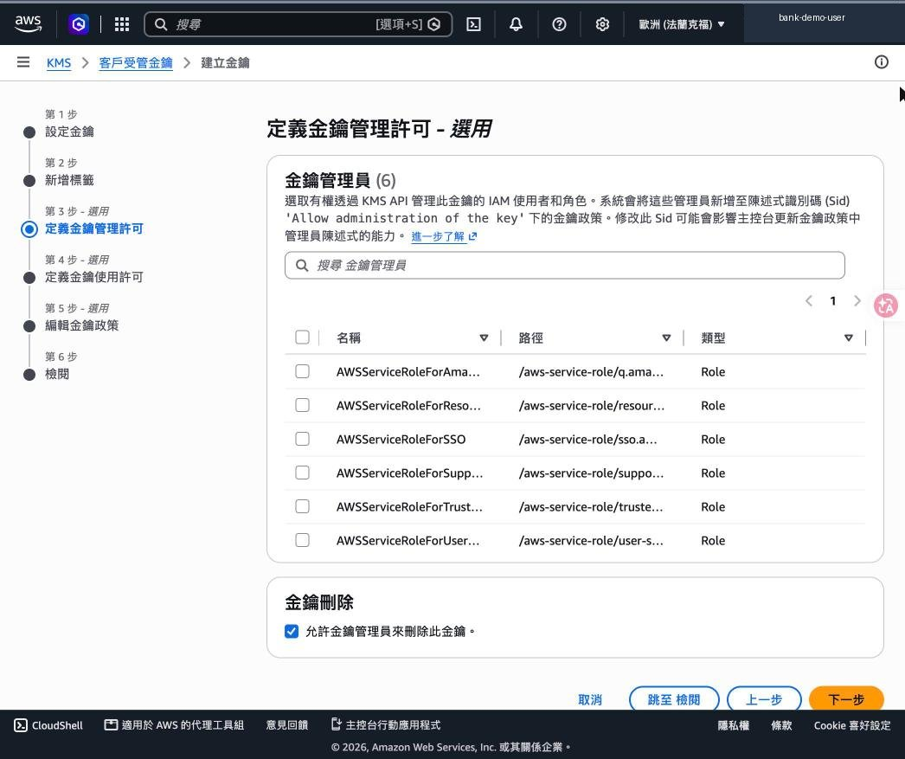

**管理金鑰的人≠使用金鑰的人**

- 金鑰管理員可修改政策、停用、排程刪除，但不應能解密資料
- 示範中未勾選任何管理員，由帳號 Root 政策兜底
- 正式環境請指定 KeyAdministrator 角色
- 「允許金鑰管理員刪除此金鑰」可依內規取消勾選

> 🏦 **銀行重點**：金鑰管理與資料使用分屬不同單位，是金融稽核對加密控制的常見要求。

## Step 5：定義金鑰使用者 `Level 101`

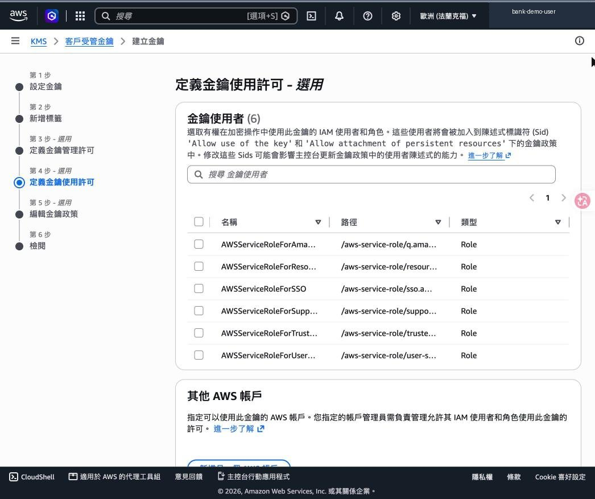

**只有應用角色能用這把金鑰**

- 勾選需要加解密的 IAM 角色（例如網銀應用的執行角色）
- 「其他 AWS 帳戶」可授權跨帳號使用
- 示範中未勾選，直接按「跳至檢閱」

## Step 6：檢閱金鑰組態 `Level 101`

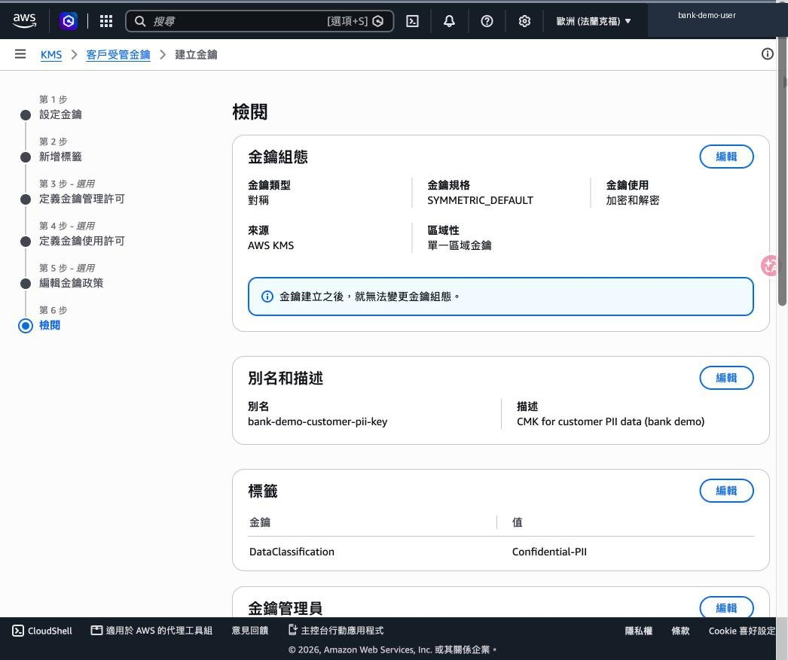

**建立後無法變更金鑰組態**

- 金鑰類型：對稱；規格：SYMMETRIC_DEFAULT
- 來源：AWS KMS；區域性：單一區域
- 別名、描述、標籤都在此確認
- 金鑰組態（類型、用途、來源）建立後不可改

## Step 7：看懂預設金鑰政策 `Level 102`

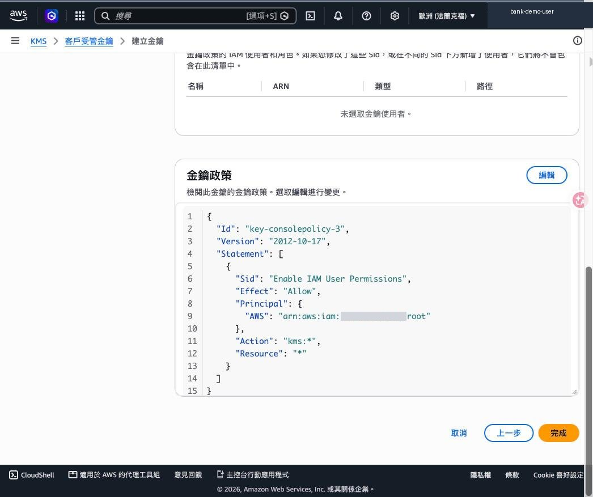

**Enable IAM User Permissions**

- 預設政策授權本帳號 root（帳號本身）kms:* 權限
- 意思是：可再透過 IAM 政策授權給角色
- 若要更嚴格，可移除此段並只列出特定角色
- 移除前務必保留至少一個可管理的主體，避免金鑰失控

> ⚠️ **注意**：金鑰政策是 KMS 存取控制的主要依據；稽核時應同時檢視金鑰政策與 IAM 政策。

## Step 8：金鑰建立完成 `Level 101`

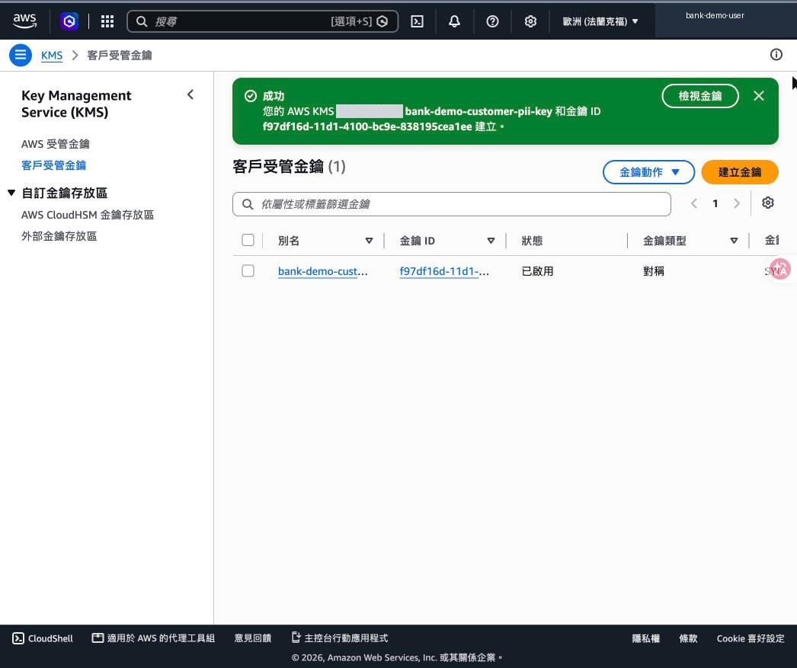

**取得金鑰 ID 與 ARN**

- 成功訊息顯示別名與金鑰 ID
- 清單中狀態為「已啟用」
- 後續 S3 加密會選用這把金鑰
- CloudTrail 會記錄 CreateKey 與 CreateAlias 事件（模組 D 可看到）

## Step 9：啟用自動金鑰輪換 `Level 101`

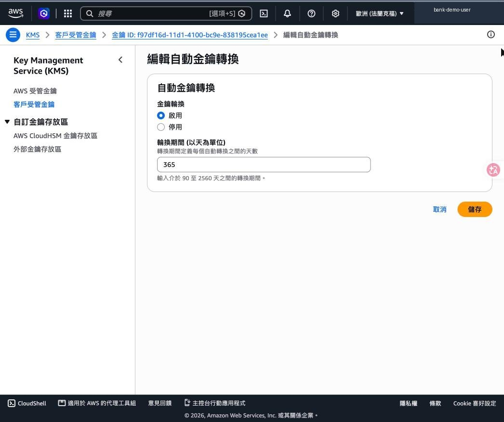

**金鑰材料和輪換 → 編輯**

- 自動金鑰輪換選「啟用」
- 輪換期間可設 90 至 2560 天，預設 365 天
- 輪換後舊資料仍可解密，新資料用新金鑰材料
- 另有「隨需輪換」可立即輪換（有次數上限）

> 🏦 **銀行重點**：輪換週期請依貴行密碼學管理規範訂定，並保留輪換紀錄。

## Step 10：確認輪換已啟用 `Level 101`

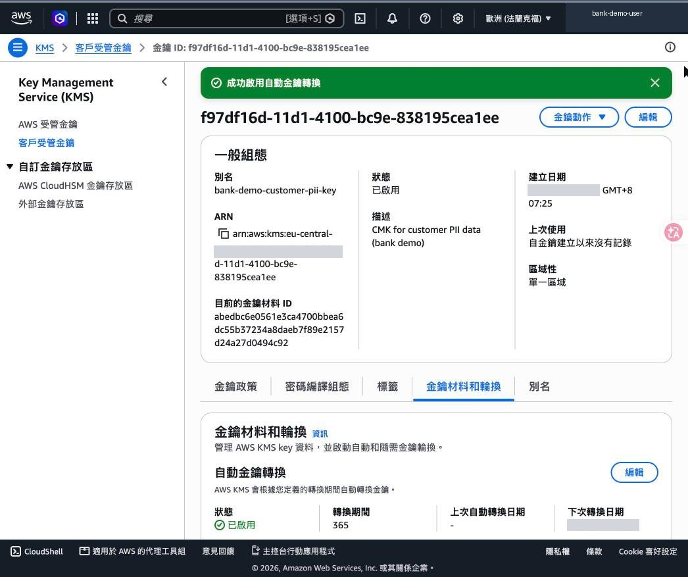

**狀態：已啟用，下次輪換日期**

- 上方出現「成功啟用自動金鑰輪換」
- 狀態已啟用、轉換期間 365 天
- 下次轉換日期自動計算
- CloudTrail 會記錄 EnableKeyRotation 事件

<details><summary>CLI 對應</summary>

```bash
./scripts/02-data-protection.sh kms
aws kms get-key-rotation-status --key-id alias/bank-demo-customer-pii-key
```
</details>

## Step 11：建立 S3 儲存貯體－一般組態 `Level 101`

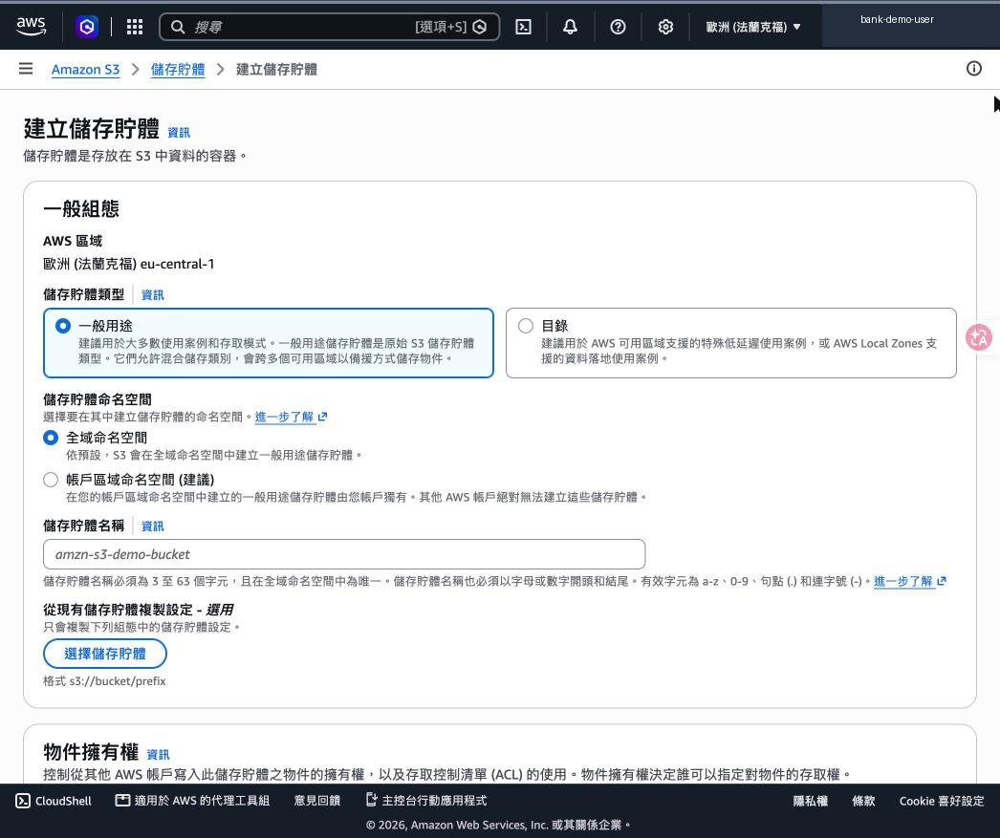

**情境：存放客戶申請文件**

- S3 → 建立儲存貯體
- AWS 區域：歐洲（法蘭克福）eu-central-1
- 類型：一般用途
- 命名空間：全域或帳戶區域（帳戶區域命名空間可避免名稱被他人搶先）

<sub>本步驟實際建立了 bank-demo-customer-docs-rx20261030，最後已刪除。</sub>

## Step 12：命名並保持 ACL 停用 `Level 101`

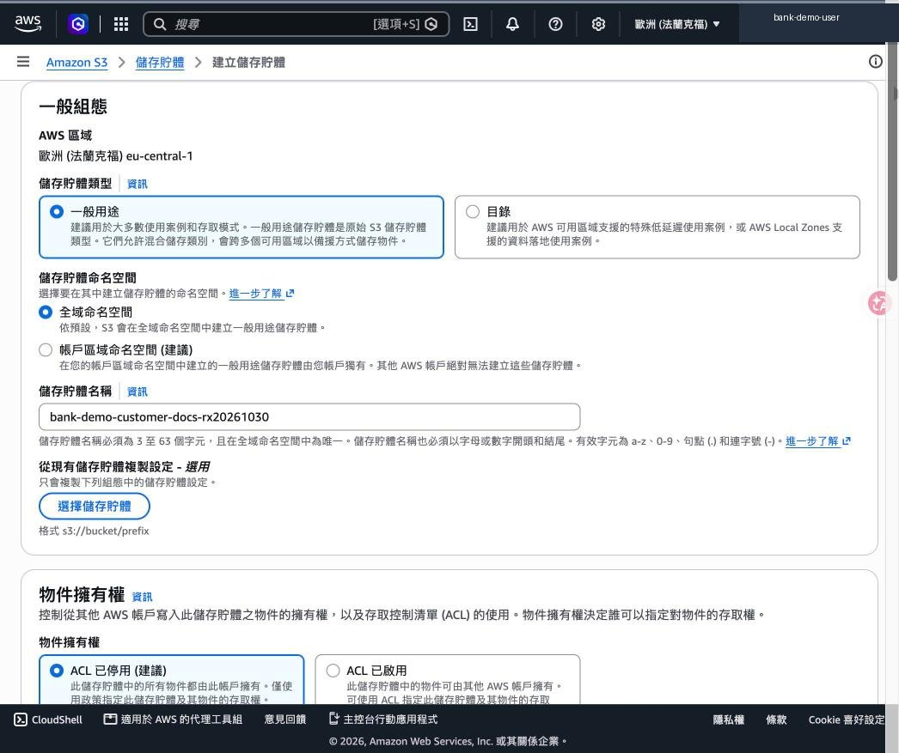

**名稱不放敏感資訊**

- 名稱：bank-demo-customer-docs-rx20261030
- 名稱全域唯一，會出現在網址中，勿包含客戶或專案機密
- 物件擁有權：ACL 已停用（建議）
- 權限統一用儲存貯體政策管理

## Step 13：封鎖所有公開存取 `Level 101`

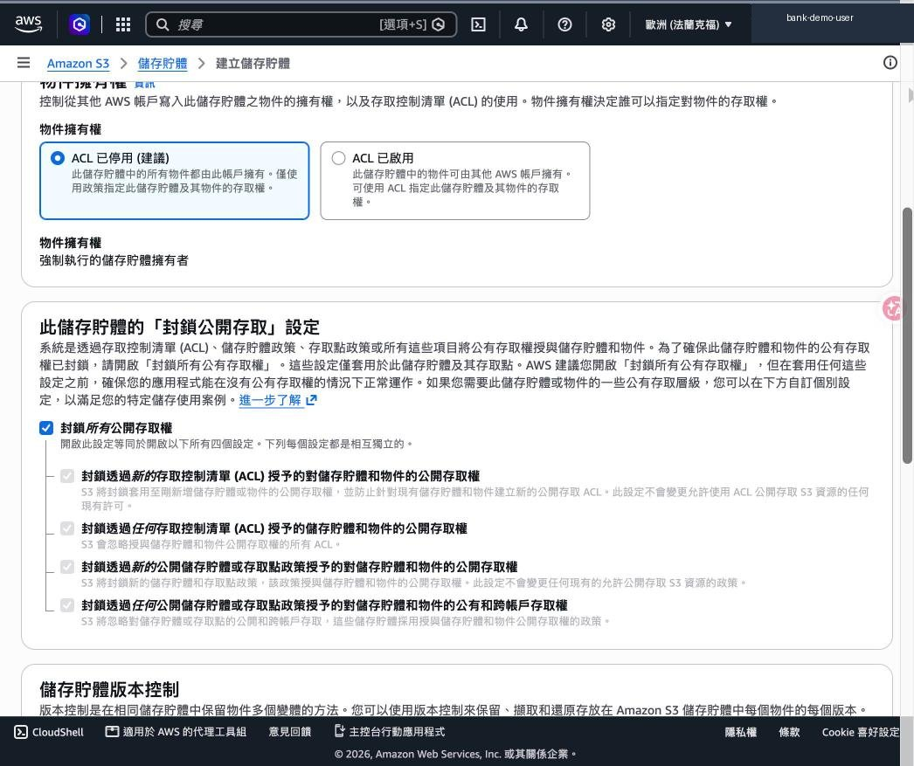

**四個子項目全部開啟**

- 勾選「封鎖所有公開存取權」
- 同時封鎖新／任何 ACL 與新／任何公開政策授予的存取
- 新建儲存貯體預設即為開啟，請勿關閉
- 帳號層級也有同樣設定（Step 22 會看到本帳號未開）

> 🏦 **銀行重點**：客戶資料桶被設為公開是雲端資料外洩最常見的原因之一。

## Step 14：啟用版本控制 `Level 101`

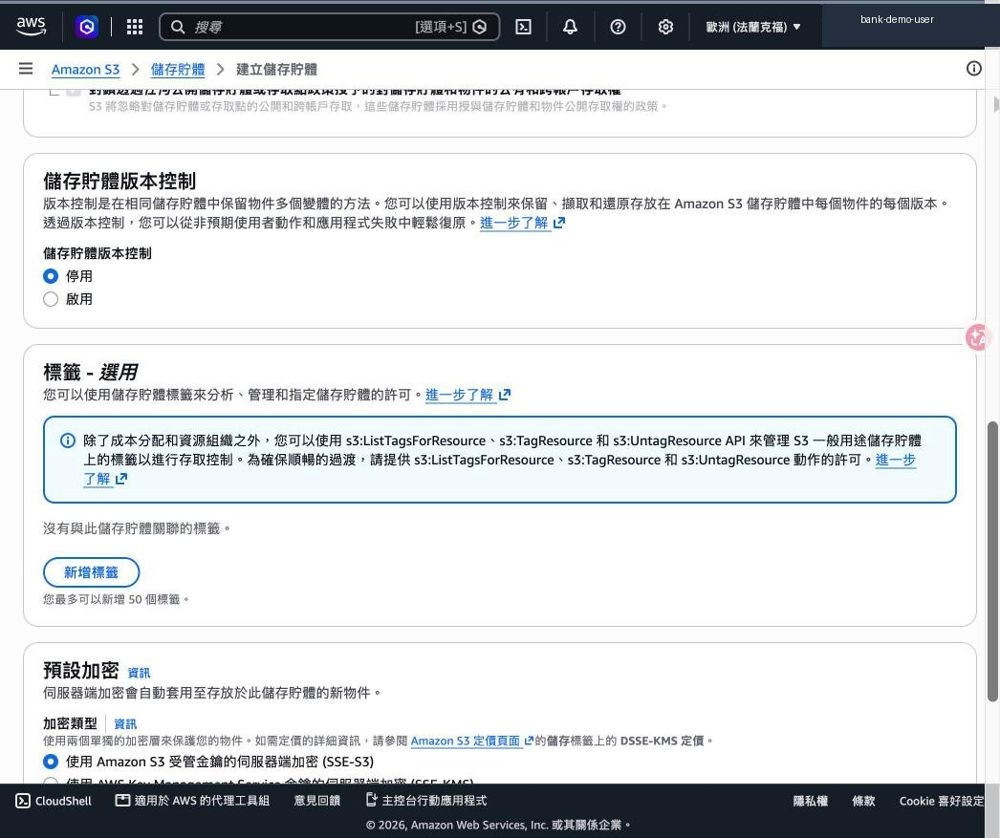

**誤刪、被勒索時能還原**

- 儲存貯體版本控制選「啟用」
- 每次覆寫或刪除都會保留舊版本
- 搭配生命週期規則控管舊版本保存天數
- Object Lock 必須在已啟用版本控制的桶上使用

## Step 15：選擇 SSE-KMS 加密 `Level 101`

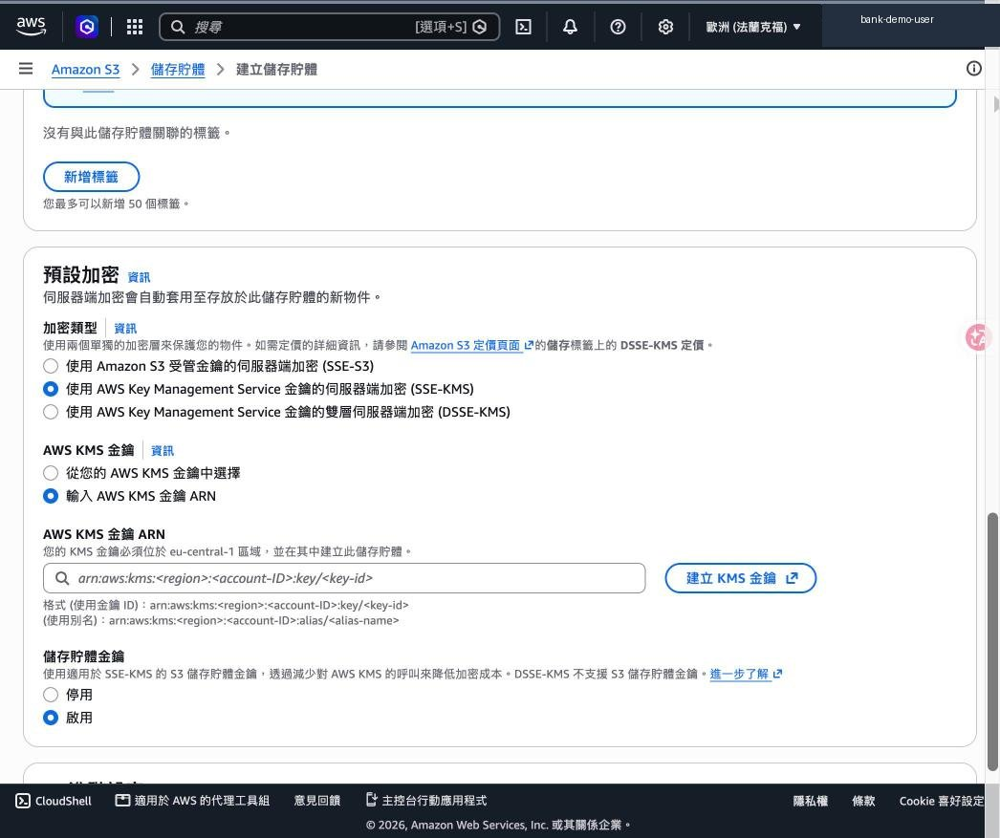

**預設加密改用 KMS**

- SSE-S3：S3 受管金鑰，最簡單
- SSE-KMS：KMS 金鑰，可控管存取並留下使用紀錄（本示範）
- DSSE-KMS：雙層加密，用於更高要求
- 儲存貯體金鑰：減少 KMS 呼叫次數與費用，建議啟用

## Step 16：指定剛建立的 CMK `Level 101`

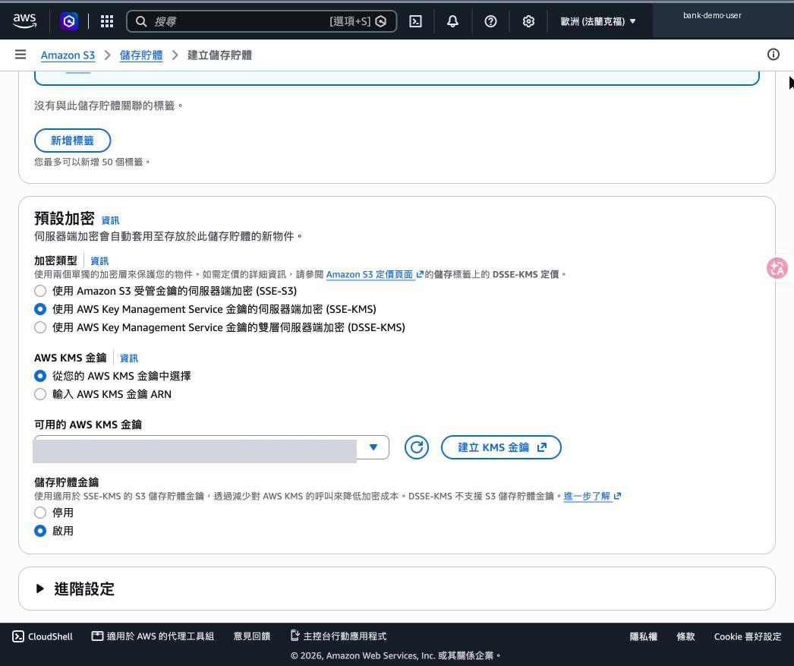

**從清單選擇 bank-demo-customer-pii-key**

- AWS KMS 金鑰：從您的 KMS 金鑰中選擇
- 清單同時列出 aws/s3（AWS 受管金鑰）與我們的 CMK
- 選擇 CMK 的 ARN
- KMS 金鑰必須與儲存貯體位於同一區域

## Step 17：認識 Object Lock（WORM） `Level 102`

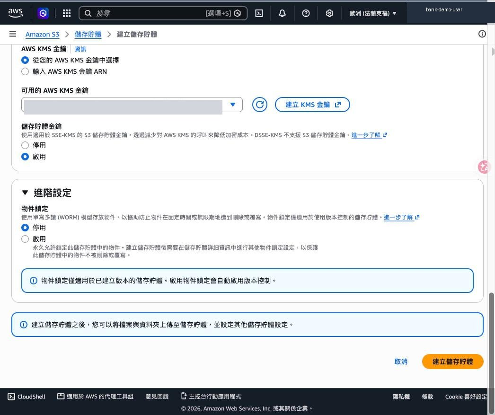

**進階設定 → 物件鎖定**

- 啟用後可防止物件在保存期間被刪除或覆寫
- 建立時啟用最單純；啟用後會自動開啟版本控制
- 合規模式：連 Root 都無法提前刪除
- 示範桶保持停用，以便最後清理

> ⚠️ **注意**：日誌封存與需長期保存的交易憑證適合使用 Object Lock；保存期限請先與法遵確認。

## Step 18：儲存貯體建立完成 `Level 101`

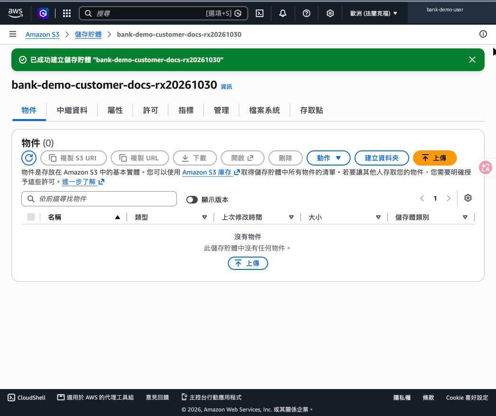

**成功建立**

- 物件數為 0
- 接下來到「屬性」與「許可」分頁驗證設定
- 實務上應以 IaC（CloudFormation / Terraform）建立，確保每個桶設定一致

<details><summary>CLI 對應</summary>

```bash
./scripts/02-data-protection.sh s3
```
</details>

## Step 19：在「屬性」分頁驗證版本控制與加密 `Level 101`

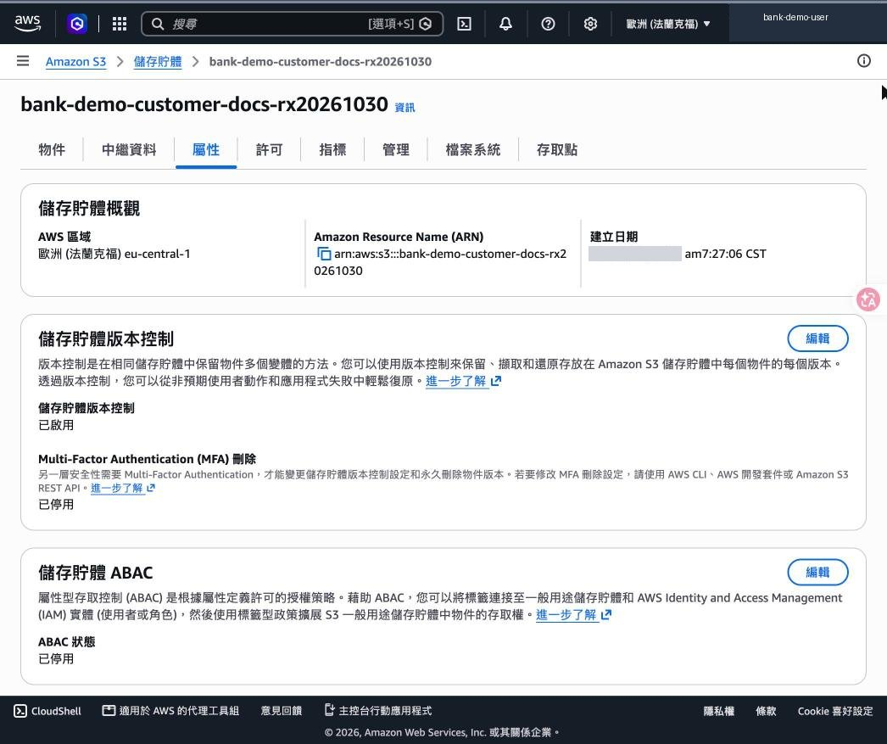

版本控制：已啟用。MFA 刪除需以 CLI 或 API 設定，可再提高刪除門檻。

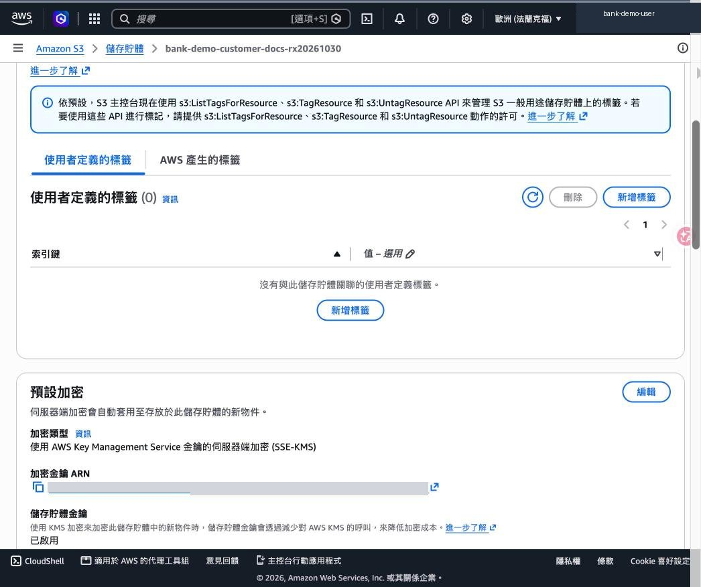

預設加密：SSE-KMS，加密金鑰 ARN 指向我們的 CMK；儲存貯體金鑰已啟用。

## Step 20：在「許可」分頁確認公開存取被封鎖 `Level 101`

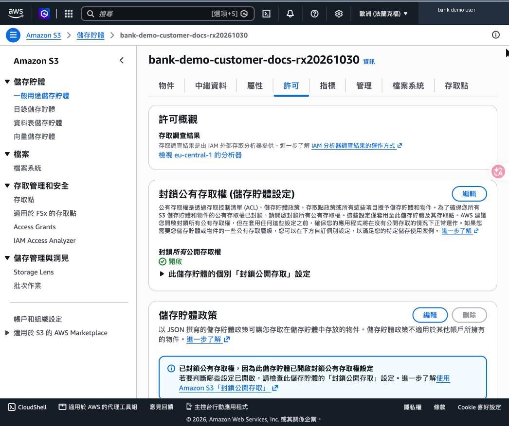

**封鎖所有公開存取權：開啟**

- 許可概觀可連到 IAM Access Analyzer 結果
- 封鎖公開存取權：開啟
- 儲存貯體政策目前為空，下一頁示範銀行常用的政策
- 存取點（Access Point）可替不同應用切分權限

## Step 21：銀行常用的儲存貯體政策 `Level 102`

```json
{
  "Version": "2012-10-17",
  "Statement": [
    {
      "Sid": "DenyInsecureTransport",
      "Effect": "Deny",
      "Principal": "*",
      "Action": "s3:*",
      "Resource": [
        "arn:aws:s3:::bank-demo-customer-docs-rx20261030",
        "arn:aws:s3:::bank-demo-customer-docs-rx20261030/*"
      ],
      "Condition": { "Bool": { "aws:SecureTransport": "false" } }
    },
    {
      "Sid": "DenyAccessOutsideVpcEndpoint",
      "Effect": "Deny",
      "Principal": "*",
      "Action": ["s3:GetObject", "s3:PutObject"],
      "Resource": "arn:aws:s3:::bank-demo-customer-docs-rx20261030/*",
      "Condition": {
        "StringNotEquals": { "aws:SourceVpce": "vpce-EXAMPLE" }
      }
    }
  ]
}
```

**兩段 Deny**

- 拒絕所有非 HTTPS 的請求（傳輸中加密）
- 物件讀寫只允許來自指定的 VPC Endpoint（模組 E 會建立）
- vpce-EXAMPLE 請換成實際端點 ID
- 第二段會連主控台上傳也一併擋下，套用前先確認維運方式

<sub>此政策僅為示意，未實際套用到示範桶。</sub>

<details><summary>CLI 對應</summary>

```bash
./scripts/02-data-protection.sh bucket-policy
# 限定 VPC Endpoint 版本：scripts/policies/s3-restrict-to-vpce.json（VPCE_ID 由 04-network.sh vpc 產生）
```
</details>

## Step 22：帳號層級的封鎖公開存取 `Level 101`

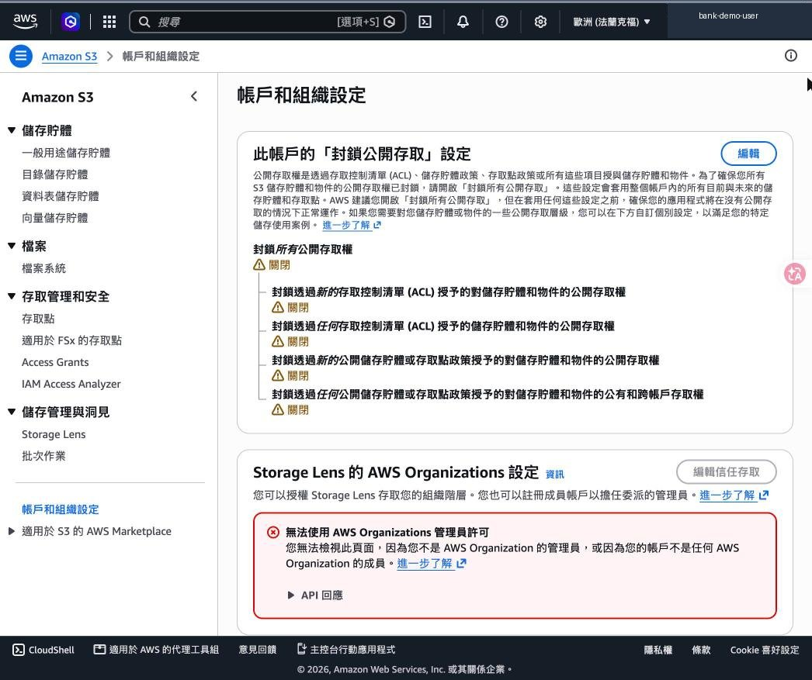

**本帳號：四項全為「關閉」**

- S3 → 帳戶和組織設定
- 此設定套用到帳號內所有現有與未來的儲存貯體
- 目前全部為「關閉」：任何桶都可能被誤設為公開
- 建議按「編輯」全部開啟（本示範未變更）

> ⚠️ **注意**：帳號層級封鎖公開存取應列為所有銀行帳號的基線，可用 SCP 禁止關閉。

<details><summary>CLI 對應</summary>

```bash
./scripts/02-data-protection.sh account-bpa
```
</details>

## Step 23：Amazon Macie－找出 S3 裡的個資 `Level 102`

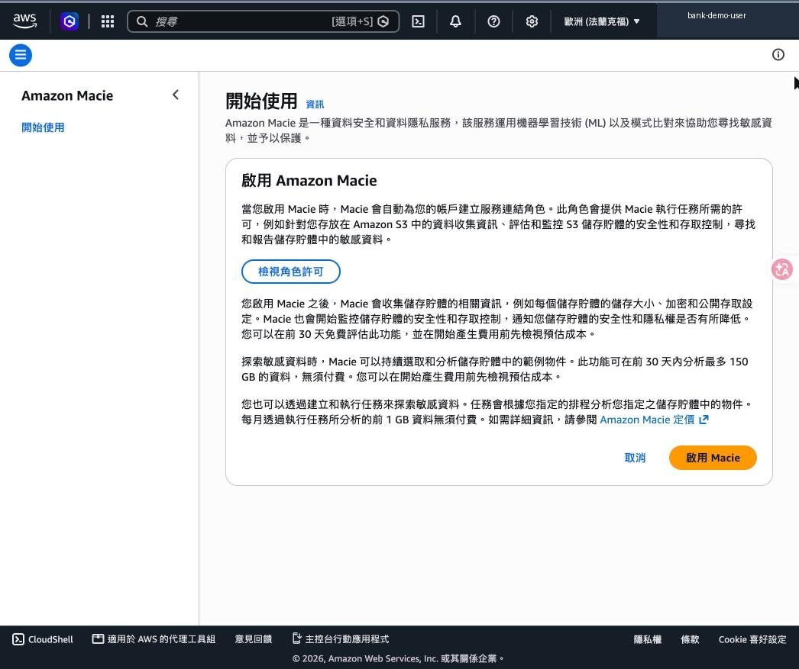

**敏感資料探索**

- Macie 以機器學習與樣式比對找出身分證號、卡號等敏感資料
- 啟用後會評估儲存貯體的加密與公開設定
- 前 30 天可免費評估，之後依掃描量計費
- 示範僅截圖到啟用頁

> 🏦 **銀行重點**：可自訂資料識別碼（例如本國身分證字號格式），作為個資盤點的佐證。

<details><summary>CLI 對應</summary>

```bash
aws macie2 enable-macie
aws macie2 create-classification-job --job-type ONE_TIME --name pii-scan \
  --s3-job-definition '{"bucketDefinitions":[{"accountId":"<帳號>","buckets":["<桶名>"]}]}'
# 停用：aws macie2 disable-macie
```
</details>

## Step 24：Secrets Manager－不再把密碼寫在程式裡 `Level 102`

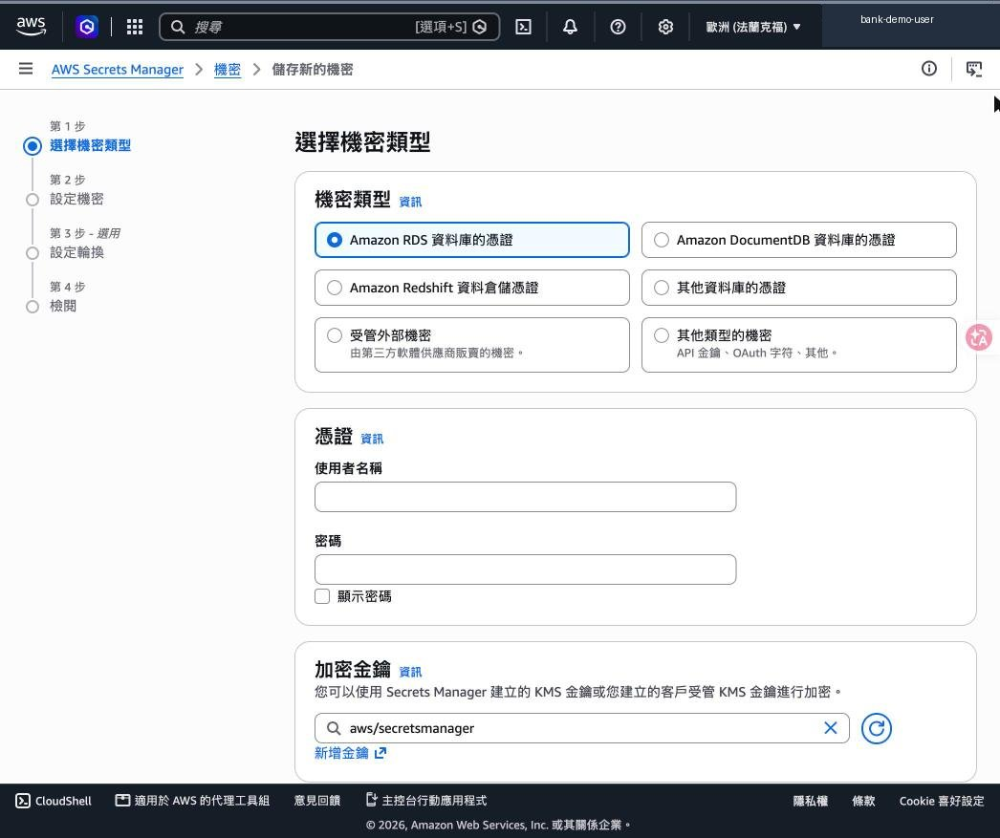

**儲存新的機密**

- 機密類型：RDS、Redshift、DocumentDB 或其他類型
- 以 KMS 金鑰加密，可改選自己的 CMK
- 下一步可設定自動輪換（RDS 憑證可一鍵輪換）
- 應用程式以 IAM 角色在執行時取回，不落地

> 🏦 **銀行重點**：示範未填入任何真實帳號密碼；正式使用時請改由自動化流程建立。

<details><summary>CLI 對應</summary>

```bash
aws secretsmanager create-secret --name bank-demo/app/db \
  --kms-key-id alias/bank-demo-customer-pii-key \
  --secret-string file://secret.json   # 不要把真實密碼寫在指令列
aws secretsmanager rotate-secret --secret-id bank-demo/app/db --rotation-lambda-arn <ARN> \
  --rotation-rules AutomaticallyAfterDays=30
```
</details>


---

[← 回到 README](../README.md)
