# 模組 D｜稽核與威脅偵測

> [模組 A](01-landing-zone.md)・[模組 B](02-identity.md)・[模組 C](03-data-protection.md)・[模組 D](04-detection.md)・[模組 E](05-network.md)・[模組 F](06-cleanup-and-checklist.md)

- 101：CloudTrail 事件歷史、Trail、AWS Config
- 102：GuardDuty、Security Hub（PCI DSS）、自動化回應

對應腳本：[`scripts/03-detection.sh`](../scripts/03-detection.sh)

## 偵測架構：四層各司其職 `Level 101`

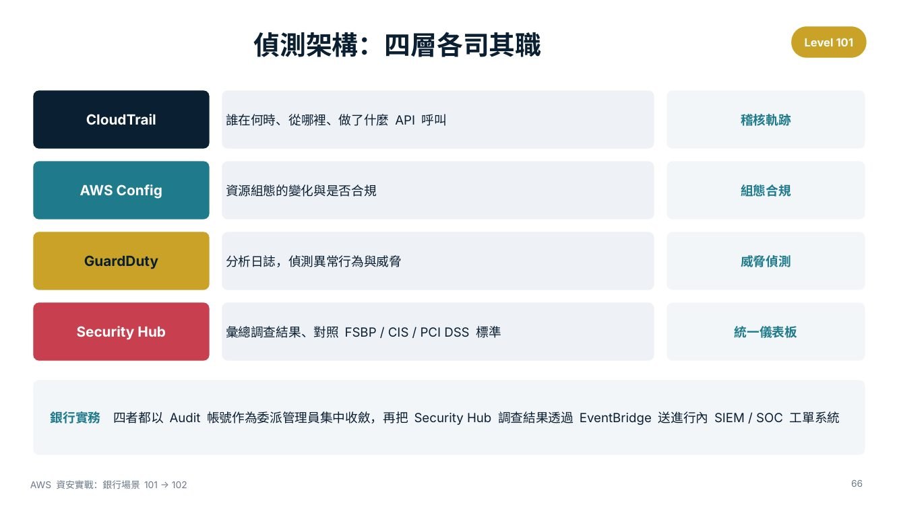

## Step 1：CloudTrail 事件歷史記錄 `Level 101`

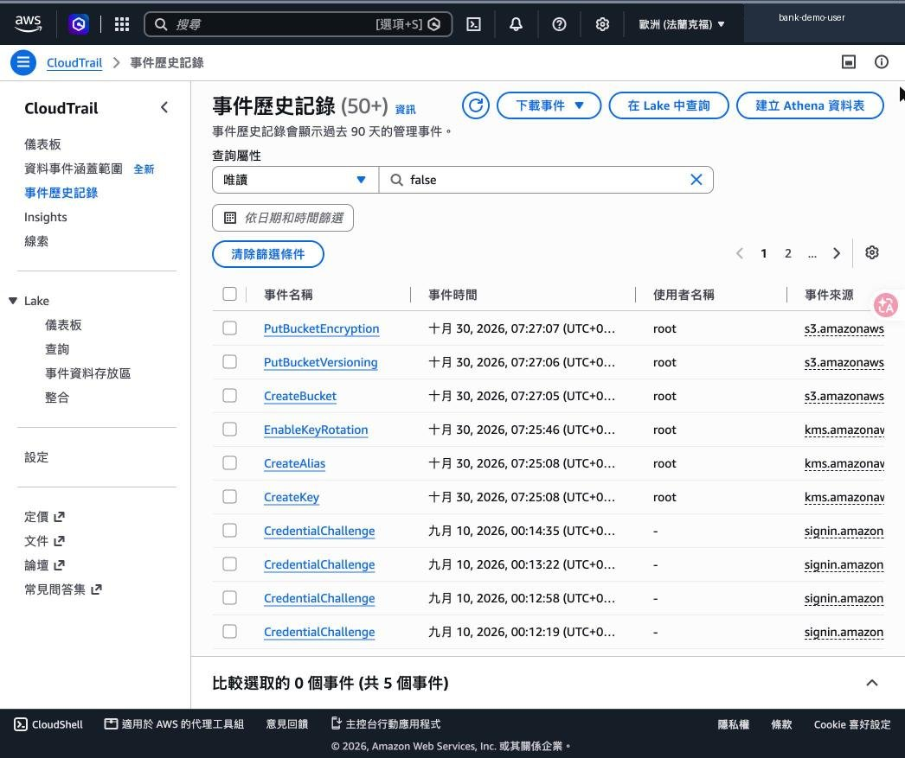

**免設定就有的 90 天管理事件**

- CloudTrail → 事件歷史記錄
- 篩選「唯讀＝false」只看變更動作
- 可看到本教材剛才的操作：CreateKey、CreateAlias、EnableKeyRotation、CreateBucket、PutBucketVersioning、PutBucketEncryption
- 使用者名稱為 root：表示這些操作是以 Root 執行的

> ⚠️ **注意**：事件歷史只保留 90 天且只在本區域；銀行需建立 Trail 長期保存到 Log Archive。

<details><summary>CLI 對應</summary>

```bash
./scripts/03-detection.sh events
```
</details>

## Step 2：檢視單一事件的細節 `Level 101`

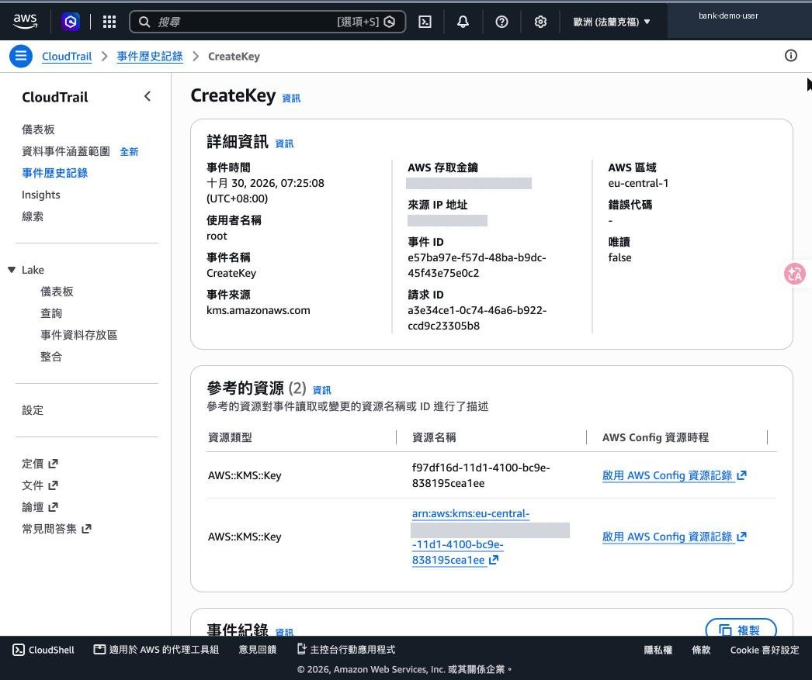

**CreateKey 事件**

- 事件時間、使用者、事件來源（kms.amazonaws.com）
- AWS 存取金鑰與來源 IP（已遮蔽）
- 參考的資源：被建立的 KMS 金鑰
- 下方「事件紀錄」為完整 JSON，可供鑑識

## Step 3：建立 Trail－儲存位置與加密 `Level 101`

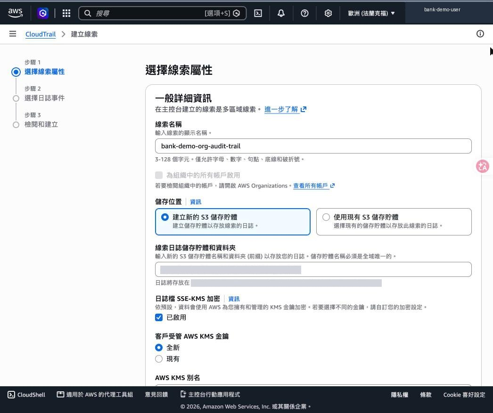

**把日誌長期送進 S3**

- 線索名稱：bank-demo-org-audit-trail
- 有組織時可勾「為組織中的所有帳戶啟用」
- 儲存位置：新建或使用 Log Archive 帳號的現有桶
- 日誌檔 SSE-KMS 加密：已啟用，可指定 CMK

<sub>本示範未建立 Trail，以免產生需清除的日誌資料。</sub>

## Step 4：開啟日誌檔驗證 `Level 101`

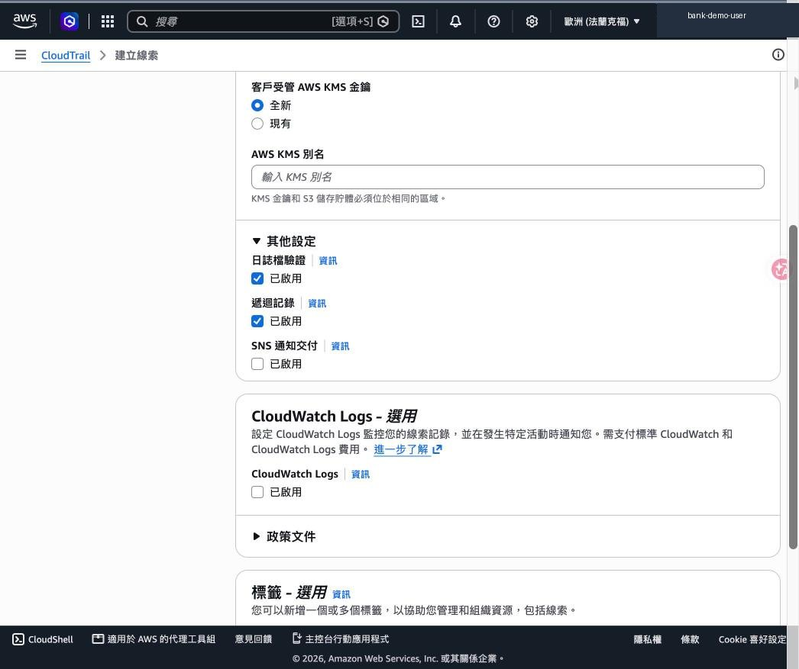

**證明日誌沒被改過**

- 日誌檔驗證：已啟用
- CloudTrail 每小時產生摘要檔，可用 CLI 驗證完整性
- SNS 通知交付：可通知下游系統有新日誌
- CloudWatch Logs：可即時建立告警（例如 Root 登入）

> 🏦 **銀行重點**：日誌完整性驗證可作為稽核軌跡未遭竄改的技術證明。

## Step 5：選擇要記錄的事件類型 `Level 101`

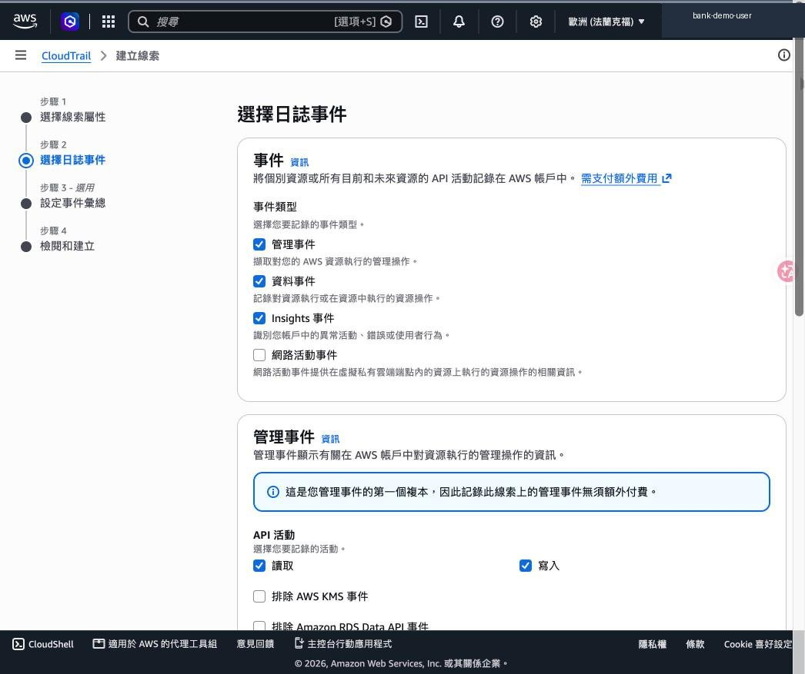

**管理、資料、Insights、網路活動**

- 管理事件：控制平面操作（第一份免費）
- 資料事件：如 S3 物件讀寫、Lambda 呼叫（另計費）
- Insights：偵測 API 呼叫量異常
- 網路活動事件：VPC 端點上的活動

## Step 6：針對客戶資料桶記錄資料事件 `Level 102`

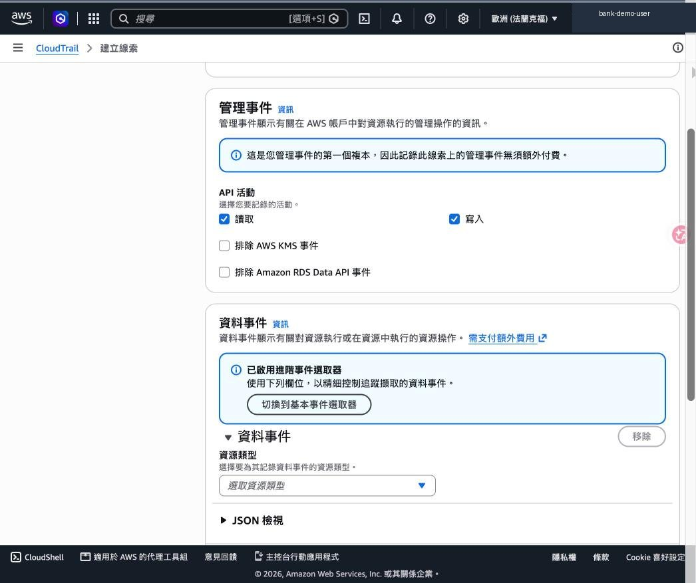

**誰讀了哪一份客戶文件**

- 資料事件使用進階事件選取器
- 資源類型選 S3，再以儲存貯體 ARN 精準篩選
- 只針對含個資的桶開啟，控制成本
- 記錄 GetObject 可追查個資被存取的軌跡

> 🏦 **銀行重點**：個資存取軌跡在事件調查與主管機關詢問時特別重要。

<details><summary>CLI 對應</summary>

```bash
./scripts/03-detection.sh trail   # 會自動對 02 建立的資料桶開啟物件層級資料事件
```
</details>

## Step 7：AWS Config－記錄資源組態 `Level 101`

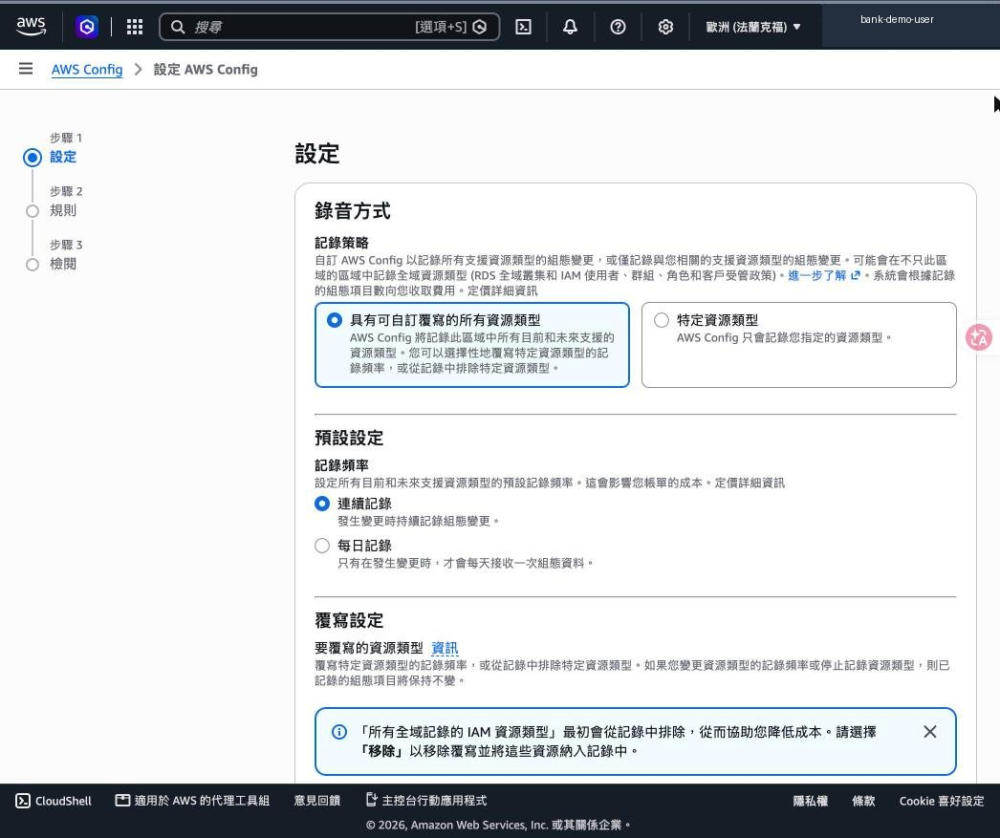

**設定 AWS Config**

- 記錄策略：所有資源類型（可排除特定類型）
- 記錄頻率：連續記錄或每日記錄（影響成本）
- Security Hub 的控制項檢查需要 Config 記錄
- 示範僅截圖，未啟用

## Step 8：挑選 AWS 受管規則 `Level 101`

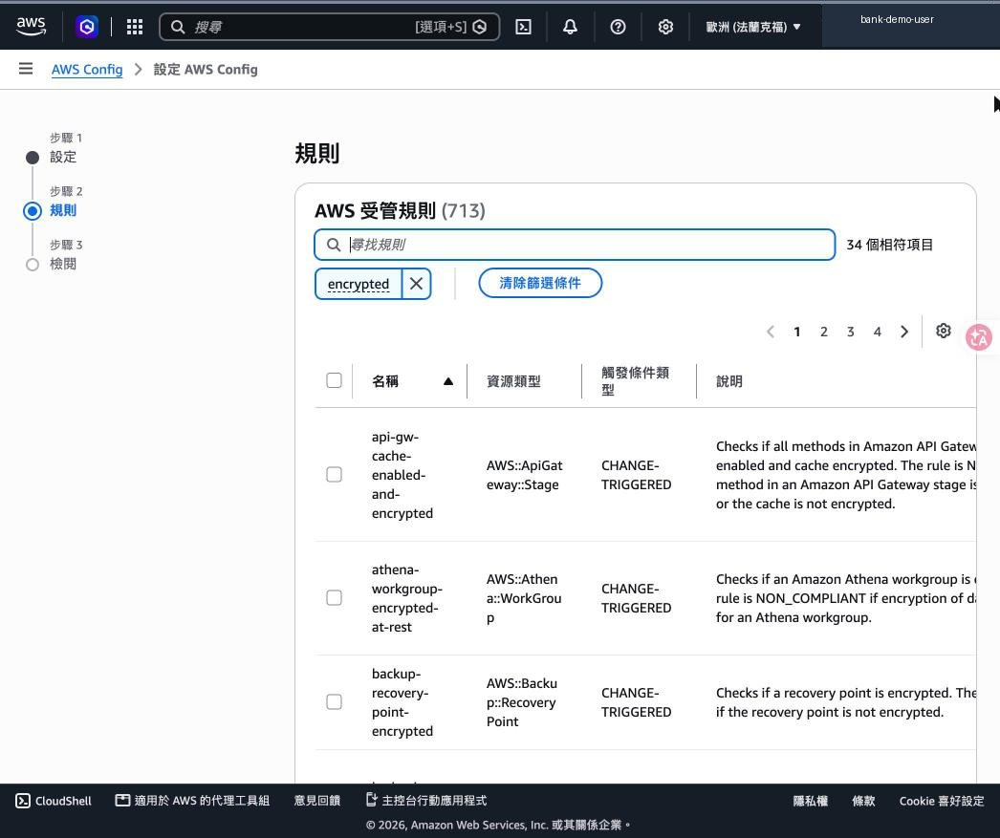

**713 條受管規則**

- 以關鍵字篩選，例如 encrypted 有 34 條
- 常用：s3-bucket-public-read-prohibited、encrypted-volumes、root-account-mfa-enabled
- 規則可設為變更觸發或定期觸發
- 也可使用一致性套件（Conformance Pack）一次部署整組規則

<details><summary>CLI 對應</summary>

```bash
./scripts/03-detection.sh config
```
</details>

## Step 9：啟用 GuardDuty `Level 102`

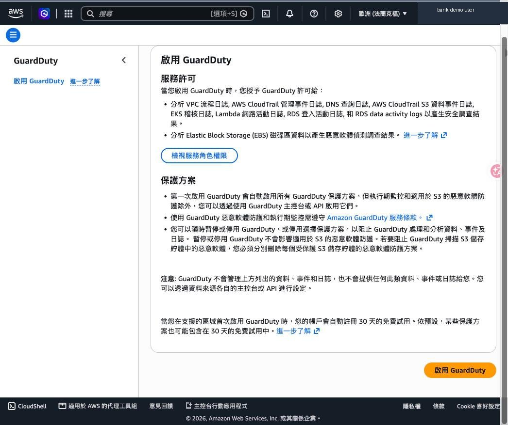

**一鍵啟用，免裝代理程式**

- 授予 GuardDuty 分析 VPC 流程日誌、CloudTrail、DNS 查詢等的權限
- 首次啟用享 30 天免費試用
- 執行期監控與 S3 惡意軟體防護需另行啟用
- 本示範實際啟用，最後已停用

## Step 10：GuardDuty 已啟用 `Level 102`

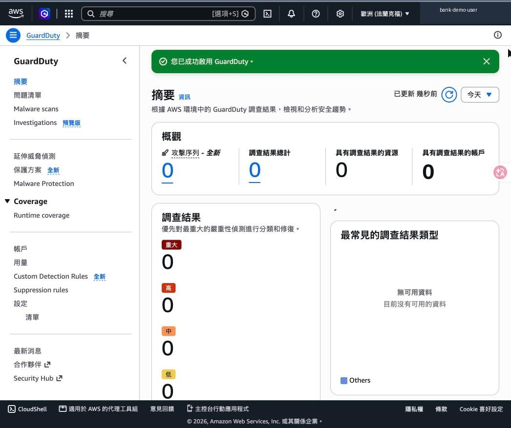

**摘要儀表板**

- 攻擊序列、調查結果總計、受影響資源與帳戶
- 依嚴重性分為重大、高、中、低
- 剛啟用時沒有資料，下一步產生範例

## Step 11：產生範例調查結果 `Level 102`

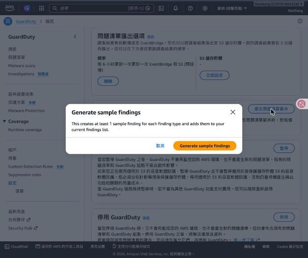

**設定 → 產生問題清單範本**

- 每種調查結果類型至少產生一筆範例
- 範例標題前會加上「[範例]」
- 用來演練 SOC 流程與 EventBridge 規則
- 不會影響任何實際資源

<details><summary>CLI 對應</summary>

```bash
./scripts/03-detection.sh guardduty
```
</details>

## Step 12：調查結果摘要 `Level 102`

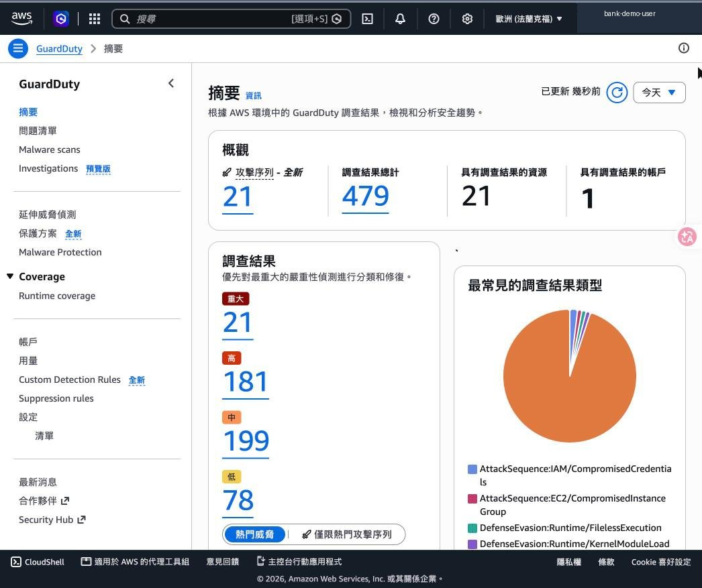

**479 筆範例、21 個攻擊序列**

- 攻擊序列把多個訊號串成一個事件，例如憑證遭竊
- 嚴重性分布：重大 21、高 181、中 199、低 78
- 最常見類型以圓餅圖呈現
- 可依時間範圍切換

## Step 13：閱讀一筆調查結果 `Level 102`

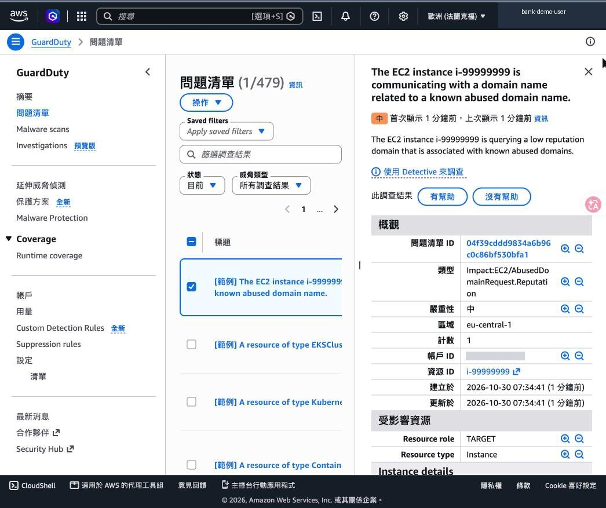

**EC2 連線到已知惡意網域**

- 類型：Impact:EC2/AbusedDomainRequest.Reputation
- 嚴重性、區域、帳戶、資源 ID、首次與最後發生時間
- 可直接「使用 Detective 來調查」
- 依此設計處置手冊：隔離執行個體、保存磁碟快照

> 🏦 **銀行重點**：建議依調查結果類型預先訂好處置手冊（Playbook），並定期演練。

## Step 14：啟用 Security Hub CSPM 並選擇標準 `Level 102`

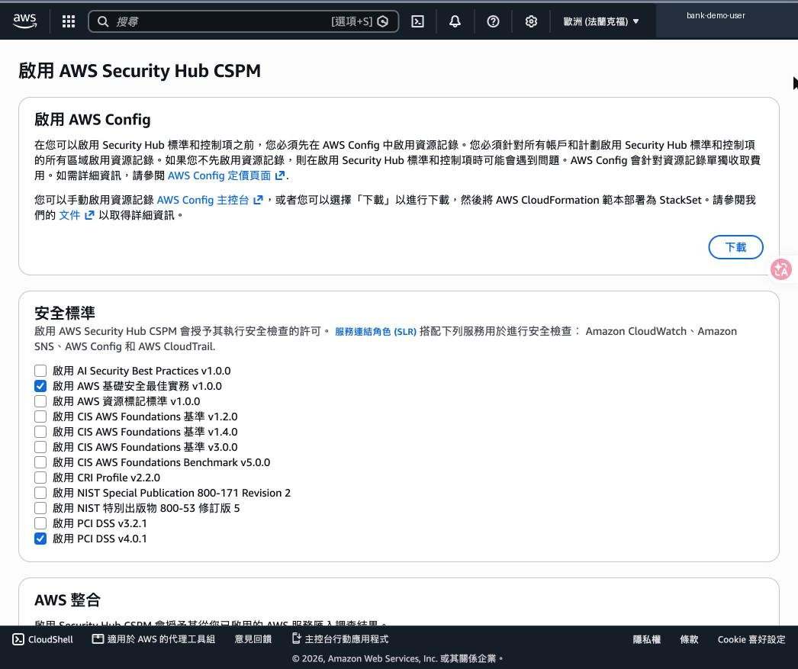

**勾選 FSBP＋PCI DSS v4.0.1**

- Security Hub 已更名為 Security Hub CSPM（另有新版 Security Hub）
- AWS 基礎安全最佳實務 v1.0.0：建議所有帳號啟用
- PCI DSS v4.0.1：給信用卡 CDE 帳號
- 也有 CIS、NIST 800-53、NIST 800-171 等
- 需先啟用 AWS Config 才能產生控制項結果

## Step 15：Security Hub 已啟用 `Level 102`

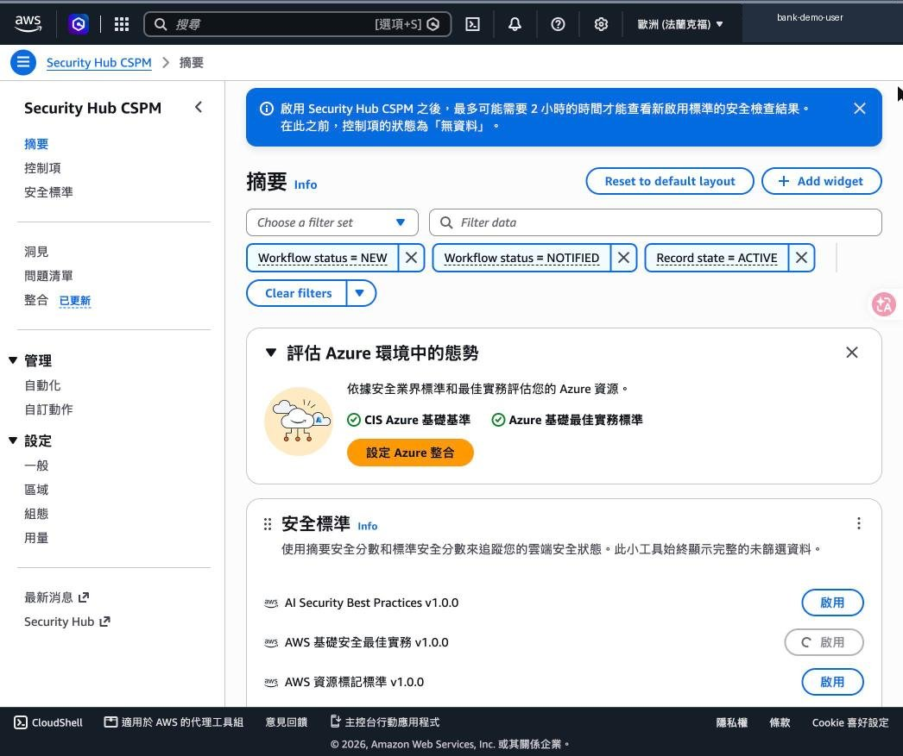

**最多約 2 小時產生檢查結果**

- 摘要頁顯示安全標準與安全分數
- 啟用後控制項狀態先為「無資料」
- GuardDuty 等服務的調查結果會自動匯入
- 本示範實際啟用，最後已停用

<details><summary>CLI 對應</summary>

```bash
./scripts/03-detection.sh securityhub
```
</details>

## Step 16：自動化規則－提升關鍵資源的嚴重性 `Level 102`

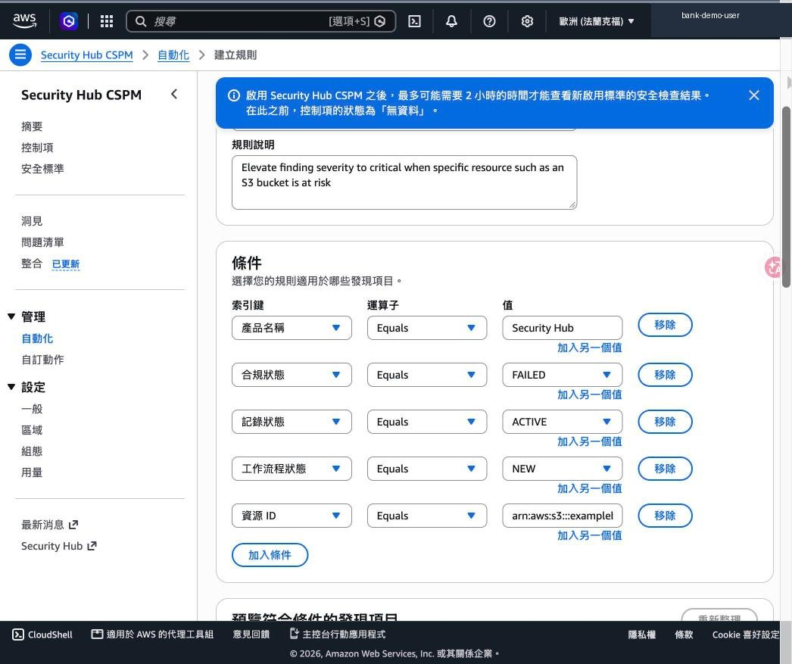

**從範本建立規則**

- 管理 → 自動化 → 建立規則 → 從範本建立
- 範本：提升重要資源相關調查結果的嚴重性
- 條件：產品、合規狀態、記錄狀態、工作流程狀態、資源 ID
- 例：客戶資料桶的 FAILED 結果自動升為 CRITICAL

> 🏦 **銀行重點**：以資料分級決定告警等級，讓 SOC 優先處理含個資或卡號的資源。

<details><summary>CLI 對應</summary>

```bash
aws securityhub create-automation-rule --rule-name elevate-pii-bucket --rule-order 1 \
  --description 'Elevate failed checks on PII bucket' \
  --criteria '{"ComplianceStatus":[{"Value":"FAILED","Comparison":"EQUALS"}],"ResourceId":[{"Value":"arn:aws:s3:::<桶名>","Comparison":"EQUALS"}]}' \
  --actions '[{"Type":"FINDING_FIELDS_UPDATE","FindingFieldsUpdate":{"Severity":{"Label":"CRITICAL"}}}]'
```
</details>

## Step 17：真實的調查結果－Root 憑證被使用 `Level 102`

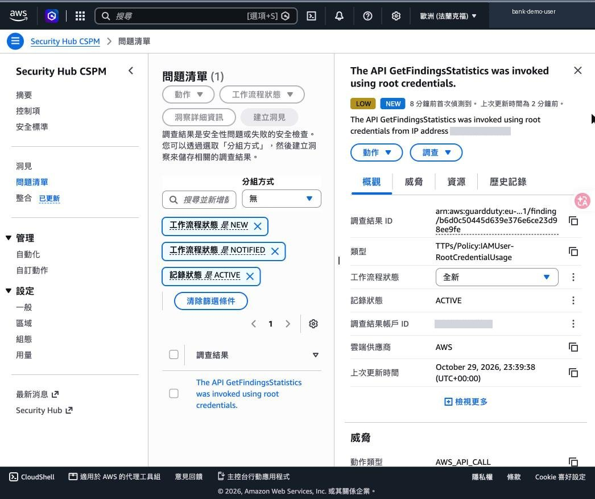

**這筆不是範例**

- 標題：API 是以 root 憑證呼叫
- 類型：TTPs/Policy:IAMUser-RootCredentialUsage
- 來源 IP 已遮蔽
- 原因：本示範以 Root 操作主控台
- 處置：建立管理用角色或 SSO 帳號，Root 僅保留緊急用途

> ⚠️ **注意**：這正是模組 B 強調「不要用 Root」的原因：偵測服務會把它當成風險行為。

## 自動化回應：從偵測到處置 `Level 102`

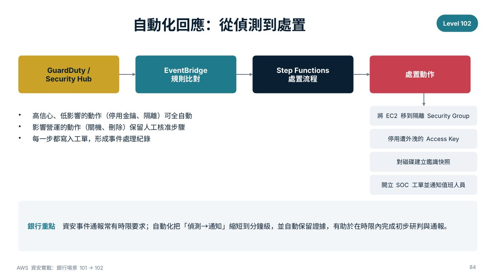

<sub>通報時限請依貴行適用法規與內部程序。</sub>

<details><summary>CLI 對應</summary>

```bash
# EventBridge 規則：GuardDuty 高嚴重性調查結果
aws events put-rule --name gd-high-severity --event-pattern '{
  "source": ["aws.guardduty"],
  "detail-type": ["GuardDuty Finding"],
  "detail": { "severity": [{ "numeric": [">=", 7] }] }
}'
aws events put-targets --rule gd-high-severity --targets Id=1,Arn=<Step Functions 或 SNS ARN>
```
</details>


---

[← 回到 README](../README.md)
