# 模組 E｜網路隔離與防護

> [模組 A](01-landing-zone.md)・[模組 B](02-identity.md)・[模組 C](03-data-protection.md)・[模組 D](04-detection.md)・[模組 E](05-network.md)・[模組 F](06-cleanup-and-checklist.md)

- 101：私有子網路、VPC Endpoint、Security Group、Flow Logs
- 102：WAF 帳號接管防護、Network Firewall、檢查 VPC

對應腳本：[`scripts/04-network.sh`](../scripts/04-network.sh)

## 銀行網路分區：三層架構＋最少的出入口 `Level 101`

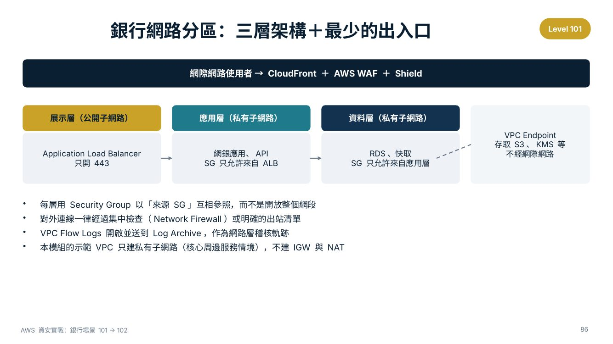

## Step 1：建立 VPC－「VPC 和更多」 `Level 101`

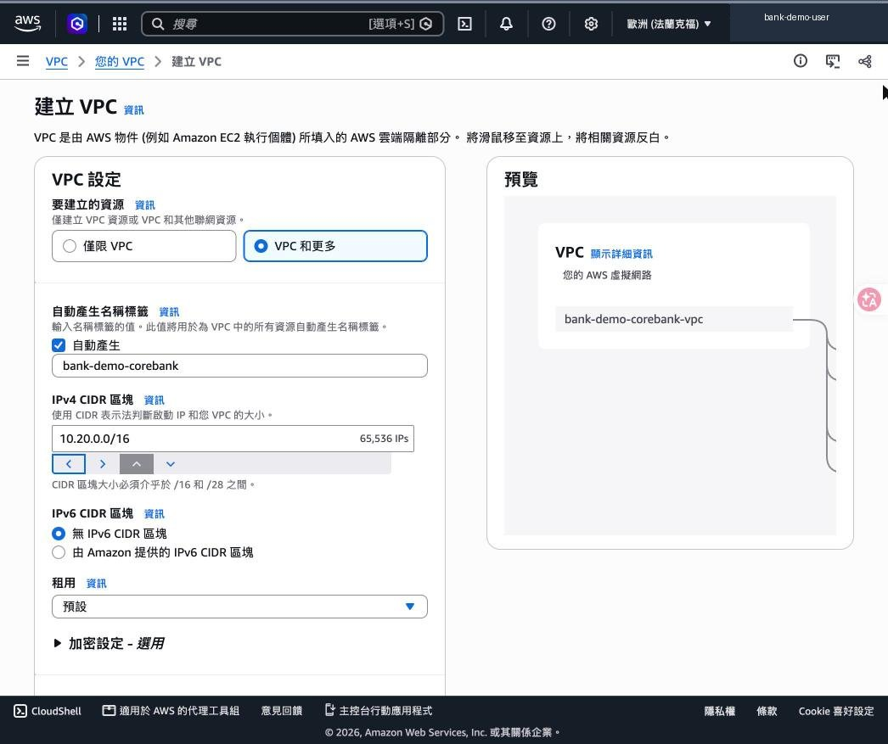

**一次建好子網路與路由表**

- VPC → 建立 VPC → 選「VPC 和更多」
- 名稱標籤自動產生：bank-demo-corebank
- IPv4 CIDR：10.20.0.0/16
- CIDR 需與行內網段規劃不衝突，才能透過 Direct Connect 互通

> 🏦 **銀行重點**：建議由網路科統一核發雲端 CIDR，避免日後各帳號網段重疊無法互連。

<sub>本步驟實際建立了 VPC、2 個私有子網路、2 個路由表與 S3 閘道端點，最後已刪除。</sub>

## Step 2：只建私有子網路，不建 NAT `Level 101`

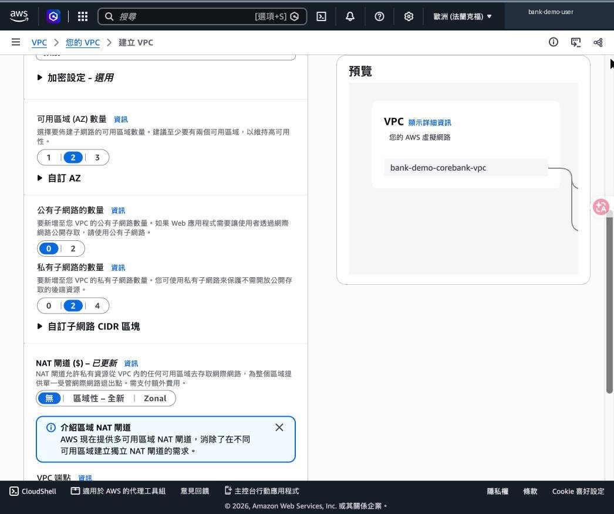

**公有子網路＝0、私有子網路＝2**

- 可用區域數量：2（高可用）
- 公有子網路數量改為 0：不會建立網際網路閘道
- 私有子網路數量：2
- NAT 閘道：無（另計費，且會產生對外出口）

## Step 3：加上 S3 閘道端點與 DNS 選項 `Level 101`

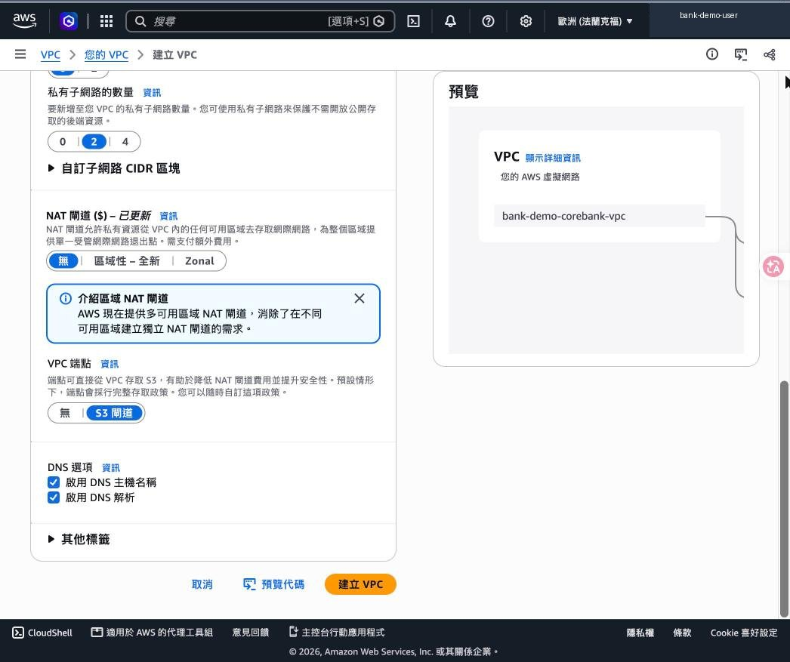

**私有子網路也能存取 S3**

- VPC 端點：S3 閘道（免費）
- 流量走 AWS 內部網路，不經網際網路
- 可搭配 Step 21 的儲存貯體政策限定只能從此端點存取
- DNS 主機名稱與解析：啟用

## Step 4：VPC 建立完成 `Level 101`

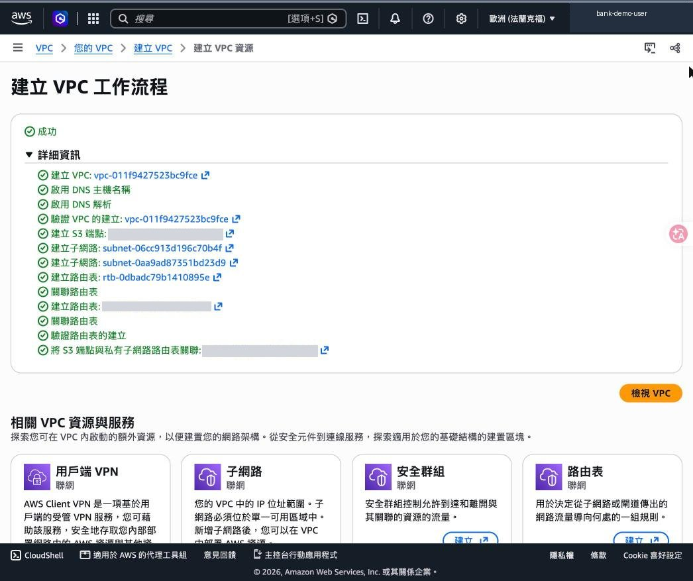

**工作流程全部成功**

- 建立 VPC、啟用 DNS
- 建立 S3 端點與 2 個子網路
- 建立並關聯 2 個路由表
- 將 S3 端點與私有子網路路由表關聯

<details><summary>CLI 對應</summary>

```bash
./scripts/04-network.sh vpc
```
</details>

## Step 5：建立 Security Group－選擇 VPC `Level 101`

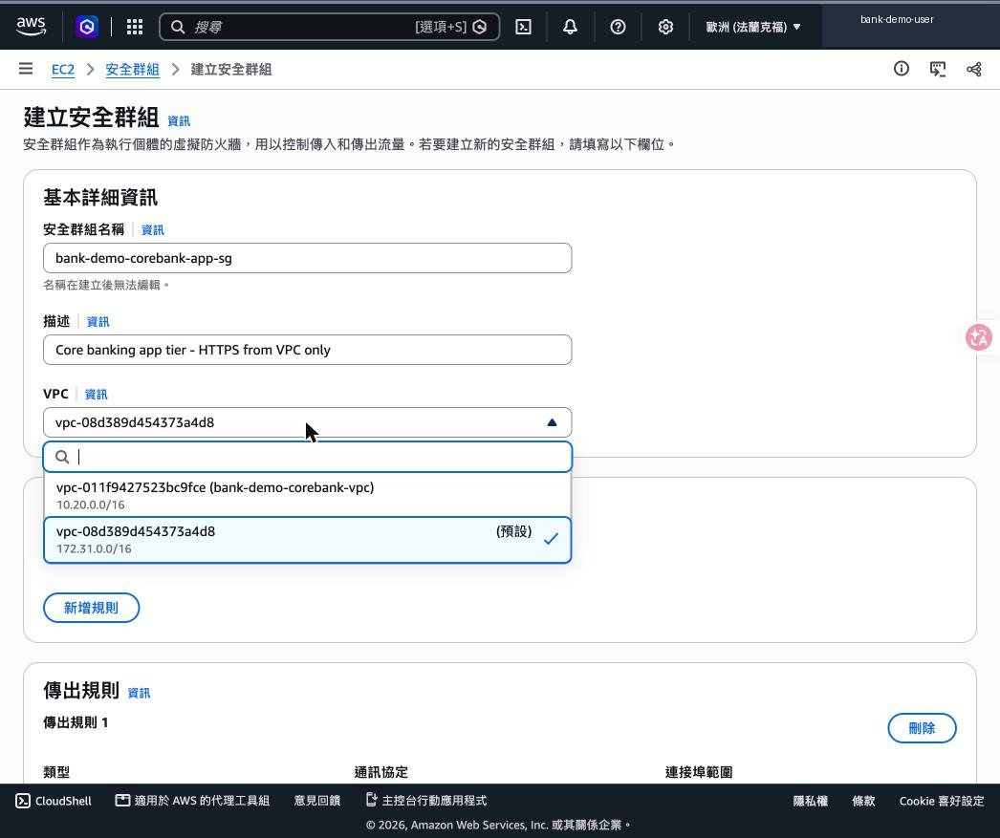

**應用層的虛擬防火牆**

- EC2 → 安全群組 → 建立安全群組
- 名稱：bank-demo-corebank-app-sg
- 描述：Core banking app tier - HTTPS from VPC only
- VPC 選剛建立的 bank-demo-corebank-vpc（不要選預設 VPC）

## Step 6：傳入規則只開 HTTPS、只限內網 `Level 101`

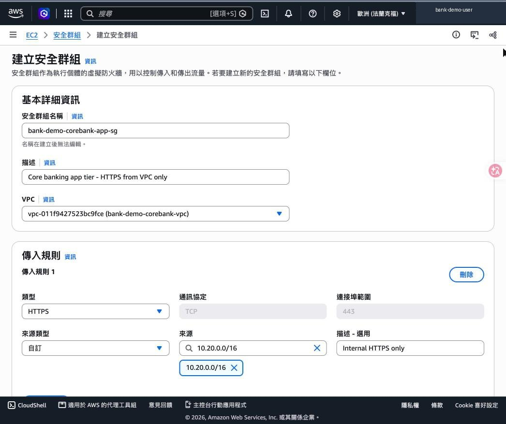

**最小開放原則**

- 類型：HTTPS（TCP 443）
- 來源：10.20.0.0/16（只限本 VPC）
- 實務上更建議以「前一層的 SG」作為來源
- 描述寫清楚用途，方便防火牆規則覆核

> ⚠️ **注意**：嚴禁 0.0.0.0/0 開放 SSH（22）或 RDP（3389）；維運改用 Systems Manager Session Manager。

## Step 7：注意預設的傳出規則 `Level 102`

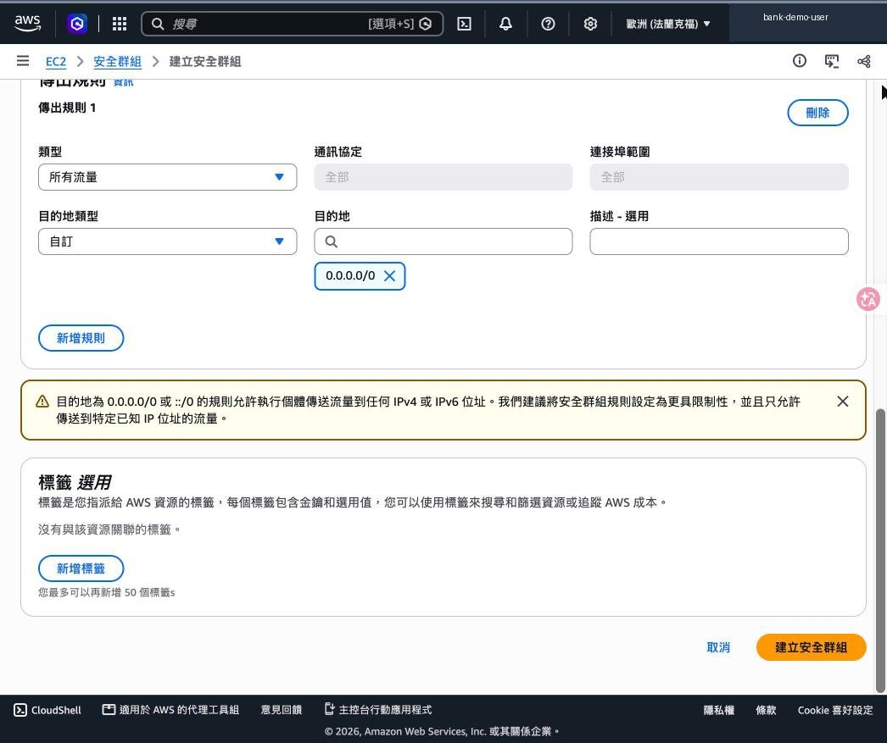

**預設允許所有對外流量**

- 傳出規則預設：所有流量到 0.0.0.0/0
- 主控台會出現警告：建議只允許傳送到特定 IP
- 銀行應限縮出站目的地，例如只允許到 VPC Endpoint 或檢查 VPC
- 出站限制是阻斷資料外洩與 C2 連線的關鍵

## Step 8：Security Group 建立完成 `Level 101`

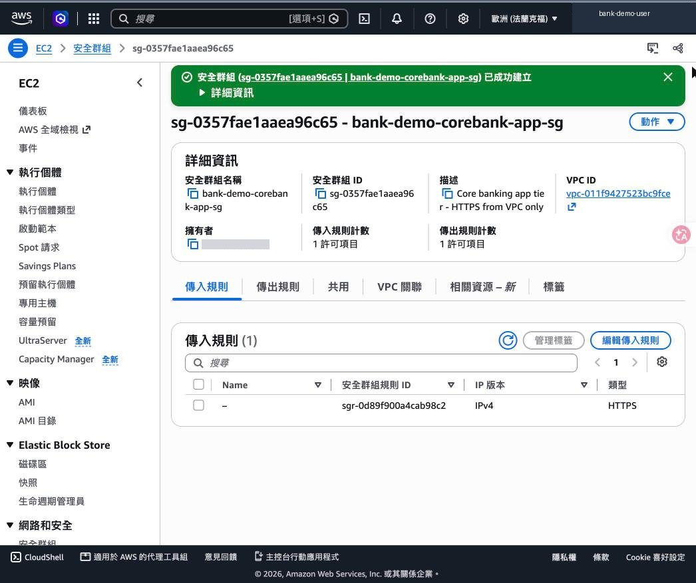

**確認傳入規則**

- 成功訊息顯示 SG ID 與名稱
- 傳入規則 1 筆：HTTPS
- VPC ID 正確指向示範 VPC
- SG 的變更都會記錄在 CloudTrail 與 Config

<details><summary>CLI 對應</summary>

```bash
./scripts/04-network.sh sg   # 同時把預設「全部出站」改為只允許 443 到 VPC 與 S3
```
</details>

## Step 9：開啟 VPC Flow Logs `Level 101`

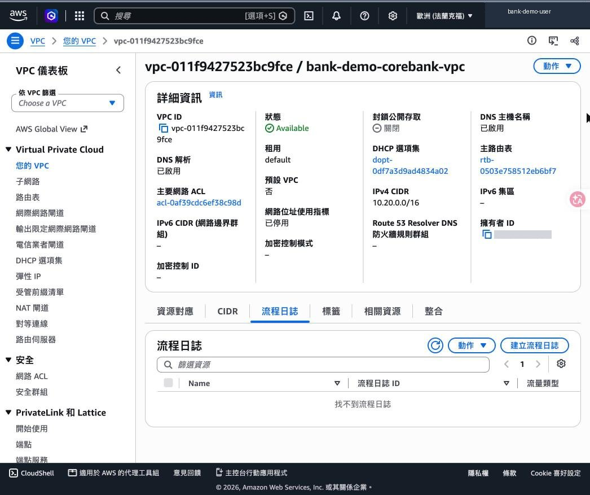

VPC 詳細資料 → 流程日誌分頁：目前沒有流程日誌，按「建立流程日誌」。

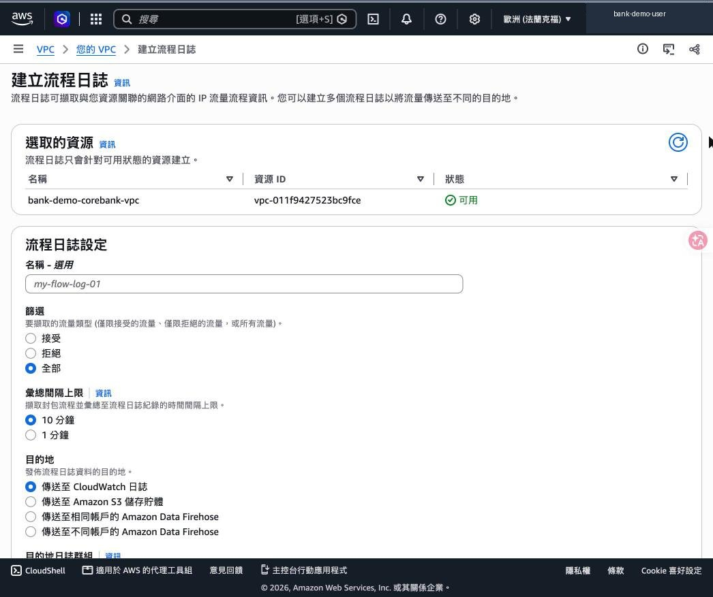

篩選選「全部」（接受＋拒絕）；目的地可選 CloudWatch 或 S3，銀行建議送到 Log Archive 帳號的 S3。本示範未建立。

<details><summary>CLI 對應</summary>

```bash
./scripts/04-network.sh flowlogs
```
</details>

## Step 10：建立 WAF Web ACL `Level 102`

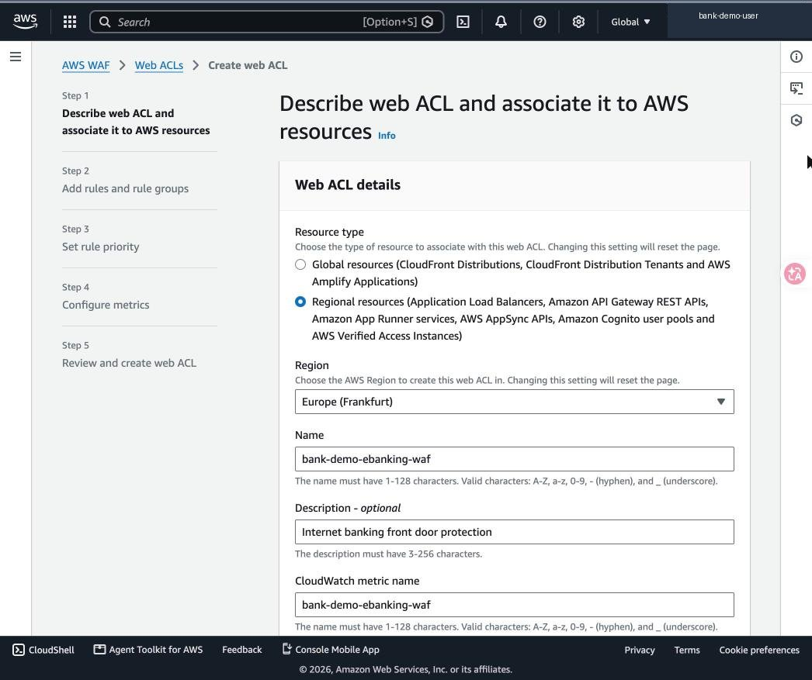

**保護網路銀行入口**

- 資源類型：區域資源（ALB、API Gateway 等）或全域（CloudFront）
- 區域：Europe (Frankfurt)
- 名稱：bank-demo-ebanking-waf
- WAF 主控台已提供新版介面，本示範使用傳統介面

## Step 11：新增受管規則群組 `Level 102`

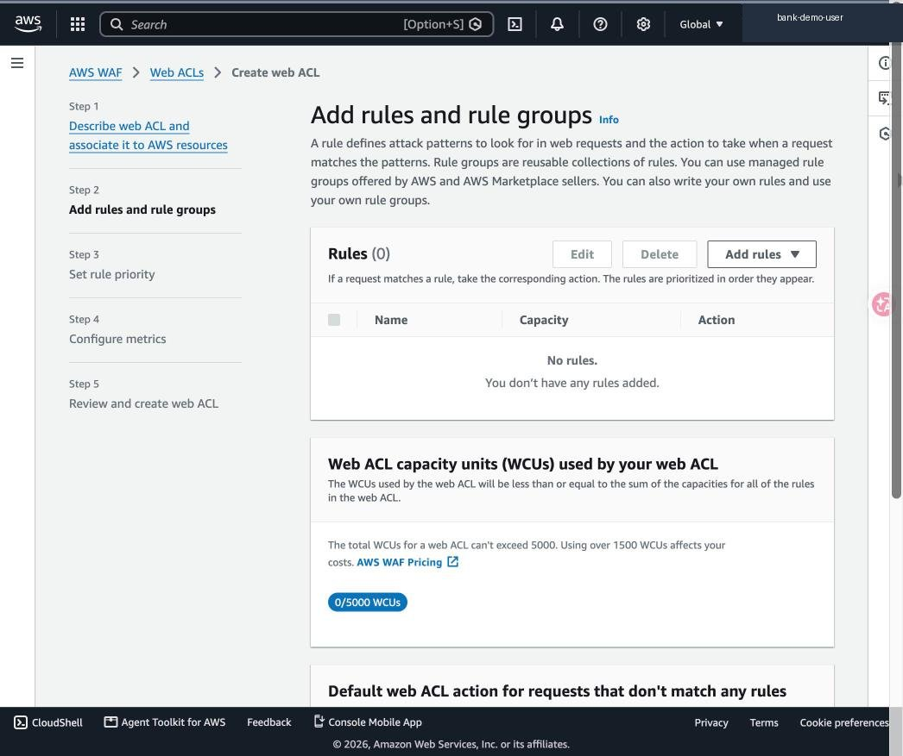

**Add rules → Add managed rule groups**

- 每個 Web ACL 有 WCU 容量上限 5000
- 超過 1500 WCU 會影響費用
- 也可自建規則：地理封鎖、速率限制
- 未命中規則時的預設動作：Allow 或 Block

## Step 12：帳號接管防護（ATP） `Level 102`

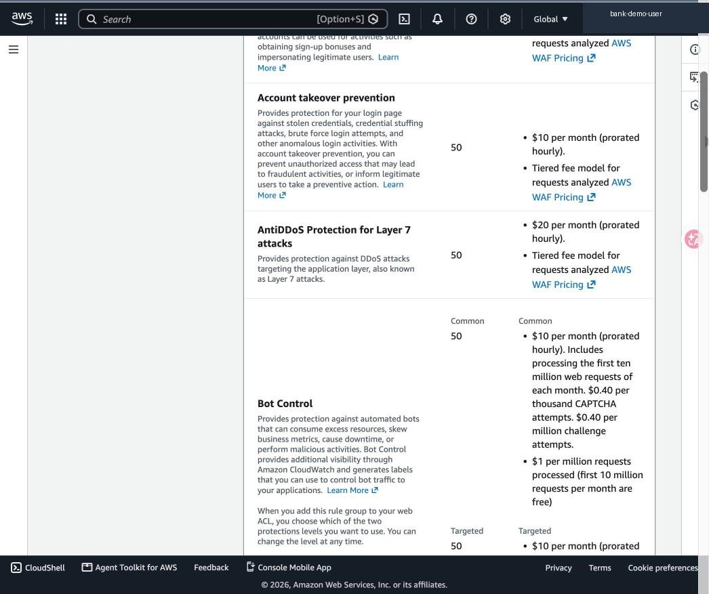

**登入頁面的撞庫與暴力破解**

- Account takeover prevention：偵測撞庫、暴力破解、異常登入
- 每月 10 美元（依小時比例）＋依請求數計費
- 另有 AntiDDoS（L7）與 Bot Control
- 需設定登入頁路徑與欄位名稱

> 🏦 **銀行重點**：網路銀行登入頁是撞庫攻擊的主要目標，ATP 可作為帳號安全的第一道防線。

## Step 13：免費規則群組 `Level 102`

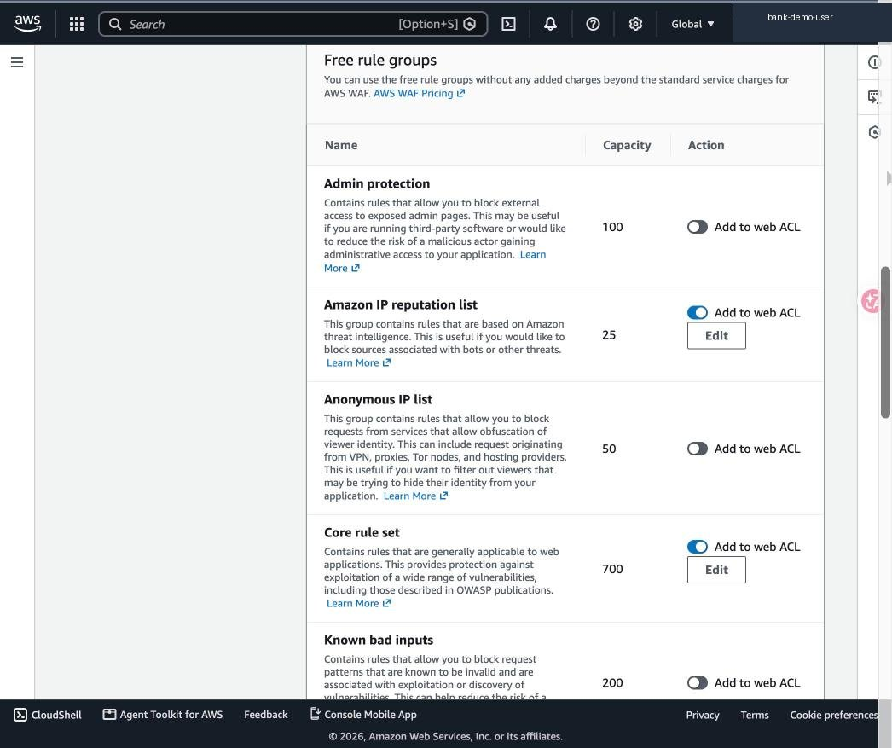

**先開這兩個**

- Amazon IP reputation list（25 WCU）：封鎖已知惡意來源
- Core rule set（700 WCU）：涵蓋 OWASP 常見弱點
- 另可加 Known bad inputs、SQL database 規則
- 先以 Count 模式觀察誤擋，再切換 Block
- 本示範未建立 Web ACL（每月有基本費）

<details><summary>CLI 對應</summary>

```bash
./scripts/04-network.sh waf
# 規則：scripts/policies/waf-managed-rules.json（Count 模式）
# 關聯：aws wafv2 associate-web-acl --web-acl-arn <ARN> --resource-arn <ALB ARN>
```
</details>

## Step 14：AWS Network Firewall（檢查出入流量） `Level 102`

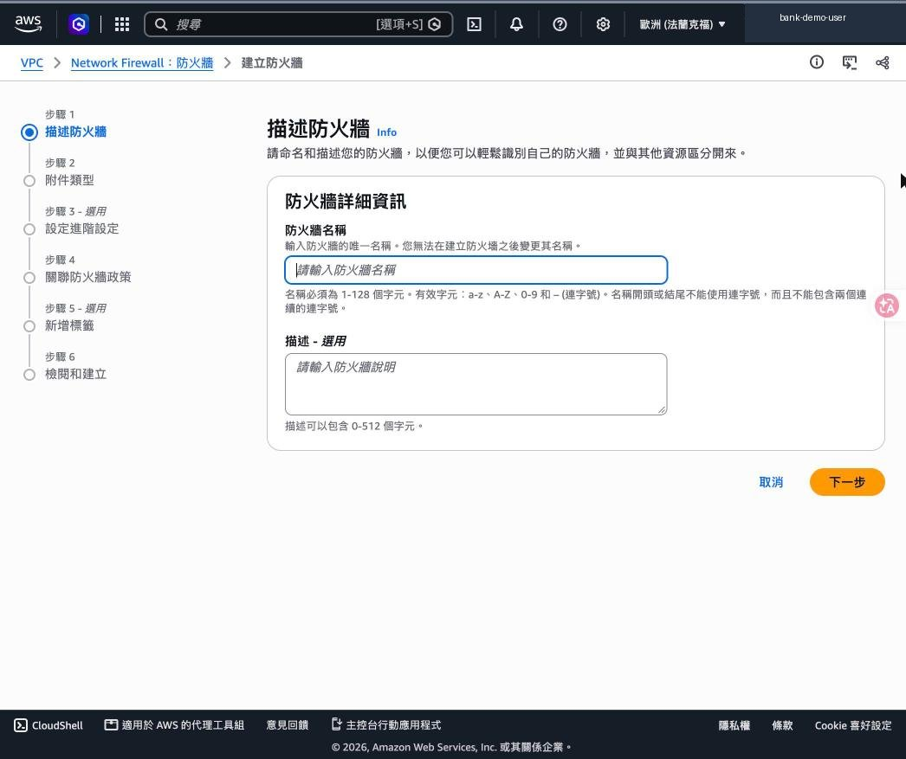

描述防火牆：名稱 bank-demo-egress-inspection，用於核心 VPC 的集中出站檢查。

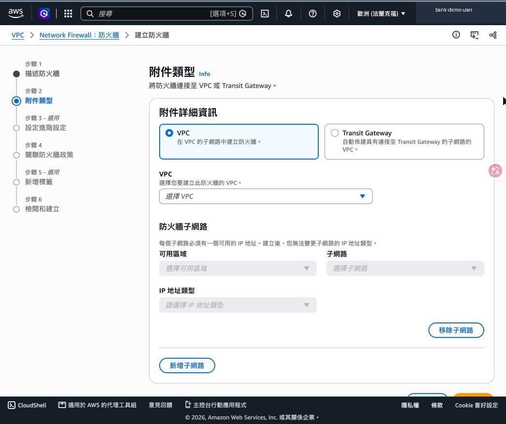

附件類型可選 VPC 或 Transit Gateway；接 TGW 可自動佈建檢查子網路。依端點小時與處理流量計費，本示範未建立。

## 102 參考架構：集中式檢查 VPC `Level 102`

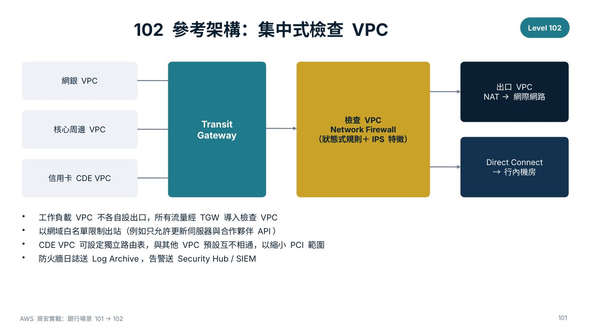


---

[← 回到 README](../README.md)
