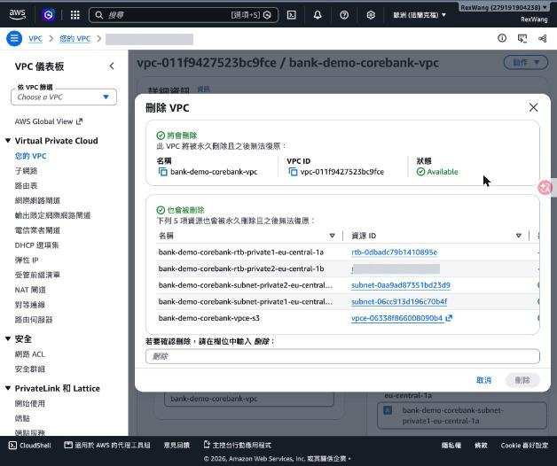
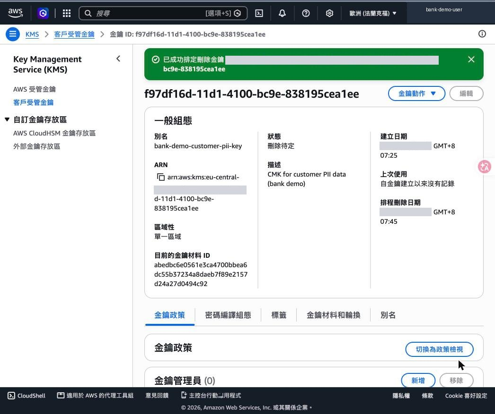

# 模組 F｜清理、發現與檢核

> [模組 A](01-landing-zone.md)・[模組 B](02-identity.md)・[模組 C](03-data-protection.md)・[模組 D](04-detection.md)・[模組 E](05-network.md)・[模組 F](06-cleanup-and-checklist.md)

- 示範資源全部刪除・本帳號的真實發現・101 / 102 檢核表

對應腳本：[`scripts/99-cleanup.sh`](../scripts/99-cleanup.sh)

## 清理順序：本示範建立的資源 `Level 101`

依相依性由上往下刪除；刪除前確認沒有任何正式資料

| # | 資源 | 清理方式 | 結果 |
|---|---|---|---|
| 1 | Security Hub CSPM | 設定 → 一般 → 停用 AWS Security Hub CSPM | 已停用 |
| 2 | GuardDuty（含 479 筆範例結果） | 設定 → 停用 GuardDuty | 已停用，結果一併刪除 |
| 3 | Security Group bank-demo-corebank-app-sg | 動作 → 刪除安全群組 | 已刪除 |
| 4 | VPC bank-demo-corebank（含子網路、路由表、S3 端點） | 動作 → 刪除 VPC，輸入「刪除」確認 | 已刪除（VPC＋5 個相關資源） |
| 5 | S3 儲存貯體（空桶） | 刪除儲存貯體，輸入桶名確認 | 已刪除 |
| 6 | KMS 金鑰 bank-demo-customer-pii-key | 金鑰動作 → 排程金鑰刪除，等待期 7 天 | 刪除待定，2026/11/06 刪除 |

<sub>GuardDuty 與 Security Hub 啟用時建立的服務連結角色保留在帳號中，不產生費用。</sub>

<details><summary>CLI 對應</summary>

```bash
./scripts/99-cleanup.sh
```
</details>

## 清理截圖：VPC 刪除與 KMS 排程刪除 `Level 101`



刪除 VPC 時會列出一併刪除的子網路、路由表與 VPC 端點，需輸入「刪除」確認。



KMS 金鑰狀態變為「刪除待定」；等待期 7 至 30 天，期間可取消，到期後無法復原。

## 本帳號的實際發現（建議立即處理） `101 / 102`

**Root 仍有存取金鑰**

- 來源：IAM 儀表板安全建議
- 風險：長期金鑰外洩即等於整個帳號失守
- 處置：IAM → 根存取管理 → 停用並刪除

**日常操作使用 Root**

- 來源：CloudTrail 事件與 GuardDuty 的 RootCredentialUsage 調查結果
- 處置：建立 Identity Center 使用者或管理角色
- Root 只保留給緊急與帳號層級操作

**帳號層級 S3 封鎖公開存取未開**

- 來源：S3 帳戶和組織設定，四項皆為關閉
- 處置：全部開啟；有公開需求的網站改用 CloudFront＋OAC

**尚未建立組織與 Landing Zone**

- 影響：無法使用 SCP、委派管理員、集中日誌
- 建議：以模組 A 流程建立，並另外準備管理帳號

<sub>以上是製作本教材時在示範帳號實際觀察到的狀態，可作為課堂上的真實案例。</sub>

## 101 / 102 檢核表 `101 / 102`

| 領域 | Level 101（每個帳號必做） | Level 102（銀行等級） |
|---|---|---|
| Landing Zone | 了解多帳號必要性 | Control Tower、OU 設計、區域拒絕、Account Factory |
| 身分與權限 | Root MFA、無 Root 金鑰、密碼政策、MFA 角色 | Identity Center＋AD、Permission Set 職責分離、SCP、Access Analyzer |
| 資料保護 | CMK、自動輪換、S3 SSE-KMS、封鎖公開、版本控制 | 金鑰管理與使用分離、Object Lock、Macie、Secrets Manager、BYOK / CloudHSM |
| 稽核與偵測 | CloudTrail Trail＋驗證、Config 規則 | Organization Trail、資料事件、GuardDuty、Security Hub PCI DSS、自動化回應 |
| 網路 | 私有子網路、VPC Endpoint、最小 SG、Flow Logs | WAF ATP、Network Firewall 檢查 VPC、TGW 集中出口、CDE 隔離 |

<details><summary>CLI 對應</summary>

```bash
./scripts/00-check-baseline.sh
```
</details>

## 下一步建議 `101 / 102`

**這週**

- 處理本帳號三項發現
- 建立 Identity Center 管理者，停止使用 Root
- 開啟帳號層級 S3 封鎖公開存取

**這個月**

- 在實驗組織演練 Control Tower
- 定義 OU、命名規則與 Permission Set
- 確認日誌保存期限與 Object Lock 模式

**這一季**

- 以 IaC 將基線納入 Account Factory
- GuardDuty / Security Hub 接 SIEM 與工單
- 與稽核室共同驗收 Landing Zone 檢核清單

<sub>結語：資安控制項要「設得起來」也要「證明得出來」，每個步驟都要留下可供稽核的紀錄。</sub>


---

[← 回到 README](../README.md)
